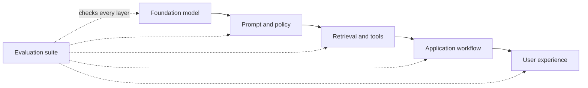
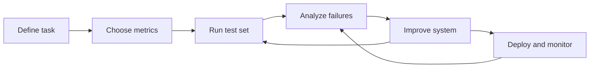
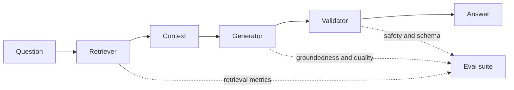
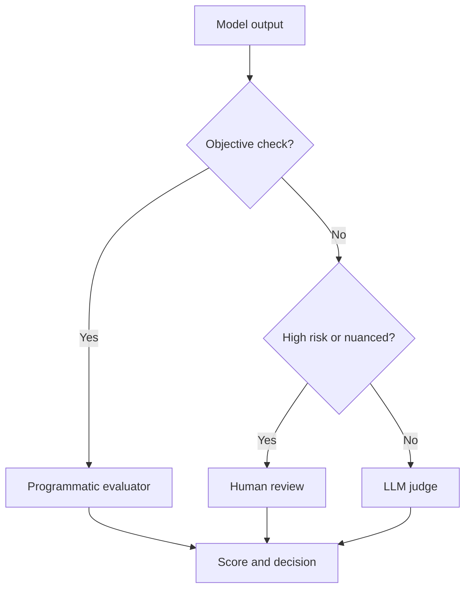

# LLM Evaluations (LLM Evals) — Short Notes

> **Numbering:** Sections are numbered continuously across Parts 1–4 so that references such as “Section 24” are unambiguous.

## 1. Moving Beyond Common Tools: Introducing LLM Evaluations
- **LLM evals** are structured tests used to measure an AI system’s quality, reliability, and safety.
- They help compare models, find failure patterns, and track improvements over time.

## 2. Two Major Career Advantages of Learning LLM Evals
- **Practical AI engineering:** Learn to test and improve AI features beyond making a working demo.
- **Career opportunities:** Build relevant skills for LLM engineering, AI quality assurance, evaluation, and AI safety roles.

## 3. The Problem with “Vibe Testing” Your AI
- **Vibe testing** means judging an AI system from a few casual prompts and subjective impressions.
- It misses edge cases and gives no reliable, repeatable performance measure.
- **Better approach:** Use test datasets, clear criteria, and repeatable evaluations.

## 4. Case Study 1: Air Canada’s Bereavement Refund Blunder
- The chatbot incorrectly said a customer could request a bereavement fare retroactively.
- In 2024, a Canadian tribunal held Air Canada responsible for the misleading information and ordered payment.
- **Lesson:** Verify policy answers against trusted sources, and evaluate high-impact customer-service responses.
- Source: [American Bar Association — Air Canada chatbot decision](https://www.americanbar.org/groups/business_law/resources/business-law-today/2024-february/bc-tribunal-confirms-companies-remain-liable-information-provided-ai-chatbot/)

## 5. Case Study 2: The “$1 Chevrolet Dealership” Jailbreak
- In 2023, a user manipulated a dealership chatbot into agreeing to sell a Chevrolet Tahoe for $1.
- The dealership did not honor the offer; the incident exposed weak instruction-following controls.
- **Lesson:** Test prompt injection and jailbreak attempts, and never let a chatbot make binding offers without safeguards.
- Source: [AIAAIC — Chevrolet chatbot incident](https://www.aiaaic.org/aiaaic-repository/ai-algorithmic-and-automation-incidents/driver-persuades-chatbot-to-sell-car-for-usd-1)

## 6. Case Study 3: Fake Legal Citations Generated by ChatGPT
- Lawyers submitted a legal brief containing fabricated cases and quotations generated by ChatGPT.
- The court imposed sanctions after the citations could not be verified.
- **Lesson:** In high-stakes work, verify every citation and factual claim against authoritative sources.
- Source: [Mata v. Avianca — court sanctions order](https://law.justia.com/cases/federal/district-courts/new-york/nysdce/1%3A2022cv01461/575368/54/)

## 7. Why Evaluating LLMs Is So Tricky
- Outputs can vary for the same prompt and may sound convincing while being wrong.
- Quality depends on context, task, user expectations, and risk level.
- A single score rarely captures the full picture; combine metrics with human review where needed.

## 8. Traditional Software Testing vs. Probabilistic LLM Evaluation
- **Traditional software:** Often checks whether fixed inputs produce expected outputs.
- **LLM systems:** Can produce many valid responses, so evaluation often checks criteria rather than exact wording.
- Use test cases, scoring rubrics, benchmarks, regression tests, and human review for ambiguous cases.

## 9. The Multi-Dimensional Check: Factuality, Tone, Groundedness, and Cost
- **Factuality:** Is the answer correct?
- **Tone:** Is the response appropriate for the audience and situation?
- **Groundedness:** Is the answer supported by the supplied context or sources?
- **Cost:** What are the latency, token, and money costs per task?
- Evaluate dimensions separately because strong performance on one does not guarantee strength on another.

## 10. Sneak Peek: RAG, Agent, Safety, and Operational Metrics
- **RAG evals:** Check retrieval relevance, context quality, and answer support.
- **Agent evals:** Check tool choice, action sequence, task completion, and recovery from errors.
- **Safety evals:** Test harmful requests, prompt injection, privacy, and policy compliance.
- **Operational metrics:** Track latency, cost, failure rate, and performance changes after updates.

-------------------
# LLM Evaluations — Notes (Part 2)

## 11. What Are LLM Evaluations?
LLM evaluations (evals) are systematic tests used to check how well a language model or AI application performs against defined requirements.

## 12. LLM Evals vs. Metrics
- **Eval:** The overall test or evaluation process.
- **Metric:** The measurement used to score a result.
- **Example:** Test whether an answer is grounded in a document (eval); calculate groundedness score (metric).

## 13. Types of LLM Evaluations
- **Offline:** Test a fixed dataset before release.
- **Online:** Evaluate real user interactions after deployment.
- **Human:** People judge quality, relevance, tone, or safety.
- **Automated:** Code, rules, or an LLM judge scores outputs.

## 14. Understanding Model Evaluations
Model evals measure a model's core abilities, such as reasoning, coding, knowledge, instruction-following, and safety. They often use curated datasets and standardized tests.

## 15. How AI Engineers Use Model Benchmarks
Benchmarks help engineers compare models on the same tasks, choose a model for a use case, track progress, and understand trade-offs. Benchmark scores may not predict performance on every real-world task.

## 16. Introduction to Application Evaluations
Application evals test the complete AI system—prompts, retrieval, tools, business logic, model output, and user experience—not just the underlying model.

## 17. Smartphone Analogy: Models vs. Applications
- **Model = processor:** Its capability matters, but it is only one component.
- **AI application = smartphone:** Overall performance also depends on software, memory, sensors, and design.
- A strong model can still produce a poor application if the surrounding system fails.

## 18. What Should We Evaluate in AI Applications?
- **Correctness:** Is the answer accurate and useful?
- **Groundedness:** Is it supported by the provided context or sources?
- **Instruction-following:** Did it meet the user's requirements?
- **Safety:** Does it avoid harmful or policy-violating output?
- **Reliability:** Does it perform consistently across cases?
- **Latency and cost:** Is it fast and affordable enough?
- **User experience:** Is the response clear and appropriately toned?

## 19. Model Evals vs. Application Evals: Recap
| Model Evals | Application Evals |
|---|---|
| Test the model's general capabilities | Test the complete AI product or workflow |
| Often use standard benchmarks | Use task-specific, real-world scenarios |
| Help select or compare models | Help validate and improve the shipped application |
| Focus on model-level strengths and weaknesses | Include retrieval, tools, prompts, safety, cost, and latency |

**Key takeaway:** Model evals tell you how capable a model is; application evals tell you how well your AI system works for its intended users.



**Example:** A model benchmark may show strong reasoning, but an application eval can still fail if the app retrieves the wrong policy document or formats the answer incorrectly.

---------------------------

# LLM Evaluations — Part 3: Application Evaluation Workflow

## 20. Recap: Why, What, and Types of LLM Evals
- **Why:** Detect errors, improve reliability, reduce risk, and track regressions.
- **What:** Tests that measure how well an LLM or AI application performs against defined expectations.
- **Types:** Model evaluations, application evaluations, human evaluations, automated evaluations, offline tests, and production monitoring.

## 21. Introduction to the LLM Application Evaluation Workflow
A repeatable cycle: **define → measure → test → analyze → improve → monitor**.



**Worked example:** For an email classifier, a release might require macro-F1 ≥ 0.90, JSON validity = 100%, and p95 latency ≤ 800 ms. A version that improves F1 but violates the latency limit is not ready to ship.

## 22. Example: Building an Email Classification LLM Application
Goal: Classify incoming emails into categories such as **work, personal, promotions, support, or spam**. The output should use an agreed label format.

## 23. Step 1: Define the Task and Target
- State exactly what the application must do.
- Define valid categories, output format, and how to handle unclear emails.

## 24. Step 2: Define Success Criteria and Metrics
Choose measurable goals, such as:
- **Accuracy:** Percentage of emails classified correctly.
- **Precision / Recall / F1:** Useful when classes are imbalanced or mistakes have different costs.
- **Latency and cost:** Time and expense per prediction.
- **Format validity:** Whether output follows the required schema.

## 25. Step 3: Build a Golden Evaluation Dataset
- Create representative examples with trusted, human-verified labels.
- Include common cases, edge cases, ambiguous emails, and every category.
- Keep evaluation examples separate from prompt-tuning examples where possible.

## 26. Step 4: Choose an Evaluation Method
- **Code-based:** Exact label match, schema checks, and standard metrics.
- **Human review:** People assess quality, ambiguity, and harmful errors.
- **LLM-as-a-judge:** Another model scores outputs using a fixed rubric; validate it against human judgments.

## 27. Step 5: Run the Model on the Evaluation Dataset
- Use the same dataset and settings to compare versions fairly.
- Save inputs, outputs, model/prompt versions, metrics, and errors.

## 28. Step 6: Evaluate and Analyze Results
- Compare results with the success criteria.
- Inspect a sample of failures and group them by cause, such as confusing categories, missing context, or invalid output.
- Check performance for each category, not just the overall score.

## 29. Step 7: Improve the System (Prompt and Model Optimization)
- Improve instructions, examples, output constraints, or preprocessing.
- Test alternative models when needed.
- Change one major factor at a time and re-run evaluations to measure its effect.

## 30. Step 8: Iterative Evaluation and Improvement Loop
Repeat **test → analyze → change → re-test**. Keep regression tests so new changes do not break previously successful cases.

## 31. Step 9: Deployment and Production Monitoring
- Deploy only after meeting release criteria.
- Monitor quality signals, latency, cost, failures, and user feedback.
- Use privacy-appropriate logging and alert on meaningful changes.

## 32. Handling Production Failures and Dataset Expansion
- Review failures and confirm their root causes.
- Add representative, verified examples to the golden dataset.
- Re-run the full evaluation suite before releasing fixes.
- Avoid adding unverified or sensitive production data without proper review and safeguards.

## 33. Why One LLM Application Needs Multiple Evaluations
One score cannot capture everything. A system can be accurate but slow, costly, poorly formatted, biased, or unsafe. Combine task quality, robustness, safety, latency, cost, and user-experience checks.

-----------------------

# LLM Evals — Part 4: Evaluation Pipelines, Risk, and Methods

## Part A — Application-Level Evaluation

### 34. Core Idea: Multiple Eval Pipelines
A reliable LLM app needs several evaluations at once: component checks, end-to-end workflow checks, safety checks, and operational monitoring. One score cannot capture every failure.

### 35. Anatomy of a RAG Setup
A typical Retrieval-Augmented Generation (RAG) pipeline is:
1. **Question** → 2. **Retriever** finds relevant chunks → 3. **Context** is assembled → 4. **LLM** generates an answer → 5. **Response** is checked and returned.



**Example:** If the answer cites a document that was never retrieved, the failure is in context assembly or citation handling—not necessarily in the model’s general knowledge.

### 36. Where Can an Application Fail?
- **Retrieval:** relevant evidence is missed or irrelevant chunks are retrieved.
- **Generation:** answer is incorrect, incomplete, or unsupported by context.
- **Workflow:** steps are misordered, inputs are lost, or tools are called incorrectly.
- **Safety:** sensitive data leaks or unsafe instructions are followed.
- **Operations:** latency, errors, or cost exceed limits.

### 37. Independent Success vs. Combined Failure
Each component can look good in isolation while the full system still fails. For example, retrieval may find useful chunks, but the generator may ignore them or misinterpret them. Evaluate both individual stages and the end-to-end result.

### 38. Scenario: The “8-Week ML Course Duration” Trap
A RAG system may retrieve a page mentioning an **8-week course**, yet answer incorrectly if it mixes that fact with another course or ignores qualifying details. Test whether the final answer is supported by the correct source and preserves the exact condition.

### 39. From Component Checks to Workflow Checks
- **Component-level:** Does the retriever find relevant chunks? Does the classifier label an email correctly?
- **Workflow-level:** Do retrieval, context assembly, generation, and validation work together in the right order?
- **Application-level:** Does the complete product satisfy the user’s goal safely, accurately, and efficiently?

### 40. Why Audit the Full Application?
Component metrics do not reveal every interaction failure. End-to-end audits verify that the complete system produces useful, grounded, safe results under realistic inputs.

### 41. Three Evaluation Levels — Recap
| Level | Main question | Example |
|---|---|---|
| Component | Does one part work? | Retriever Recall@K |
| Workflow | Do connected steps work together? | Retrieved context reaches the answer generator |
| Application | Does the whole product meet its goal? | User receives a correct, safe answer at acceptable cost |

### 42. Multi-Dimensional Risk Categories
Evaluate more than correctness. Consider **quality**, **safety**, and **operations**, then set acceptance thresholds for each.

### 43. The Three Pillars
- **Application quality:** correctness, relevance, completeness, groundedness, instruction following, and tone.
- **Safety:** toxicity, privacy/data leakage, prompt-injection and jailbreak resistance, and policy compliance.
- **Operations:** latency, throughput, availability, failure rate, and cost per request.

### 44. Useful Metrics by Application Type
- **Summarization:** factual consistency, coverage of key points, relevance, and conciseness.
- **RAG:** context precision/recall, answer correctness, faithfulness/groundedness, and citation quality.
- **Chatbots:** helpfulness, relevance, coherence, tone, task completion, and safe refusal when required.
- **Agents:** task success, correct tool selection/use, valid arguments, step efficiency, and recovery from tool errors.

### 45. Safety Guardrails Matrix
| Risk | Example check |
|---|---|
| Toxicity / harmful output | Test known risky prompts and score harmfulness |
| Sensitive-data leak | Ask for private data and verify it is not exposed |
| Jailbreak / prompt injection | Try instructions that conflict with system rules |
| Unsafe action | Verify that consequential actions require the correct checks or approval |

Use diverse adversarial cases, record failures, and re-run them after every meaningful change.

### 46. Operational Audits
- **Latency:** measure end-to-end response time, including percentiles such as p50 and p95/p99.
- **Load testing:** measure latency, errors, and throughput at expected and peak traffic.
- **Cost per request:** total model, retrieval, tool, and infrastructure cost divided by completed requests.
- Monitor all three over time; averages alone can hide slow tail requests or occasional expensive calls.

---

## Part B — LLM Evaluation Methods

### 47. What Is an Evaluation Method?
An eval method is the mechanism used to judge an output against a criterion, such as an exact expected answer, a human rubric, or a model-generated score.

### 48. Three Core Execution Styles
1. **Programmatic/deterministic:** rules, exact matches, calculations, or known labels.
2. **Human-based:** people judge quality using a rubric or comparative preference.
3. **Model-graded:** another LLM scores the output against explicit criteria.

These methods can be combined in one evaluation pipeline.



**Rule of thumb:** Use code for exact labels and schemas, humans for high-stakes nuance, and an LLM judge for scalable open-ended checks after calibration.

### 49. Example: Zomato Email Classifier
Task: classify incoming emails into labels such as **order issue**, **refund**, **delivery**, or **general query**. Create labeled examples, run the classifier, then compare predictions with expected labels using accuracy, precision, recall, and F1. Add human review for ambiguous or high-impact cases.

### 50. Method 1 — Programmatic / Deterministic Evaluation
Best when the answer or rules can be checked objectively. Examples: exact label match, JSON schema validity, required fields present, correct tool name, or numeric tolerance. It is fast and repeatable, but does not fully measure subjective qualities such as helpfulness.

### 51. Retriever Evaluation and Recall@K
**Recall@K** measures how many relevant documents appear in the top *K* retrieved results.

\[
\text{Recall@K} = \frac{\text{Relevant items in top K}}{\text{Total relevant items for the query}}
\]

**Example:** If a query has 4 relevant chunks and the top 5 results contain 3 of them, Recall@5 = 3/4 = **0.75 (75%)**.

### 52. Improving the Retriever
Test embedding models, chunk size/overlap, metadata filters, query rewriting, and different values of **K**. Measure retrieval quality and final answer quality together: increasing K may add useful evidence, but can also introduce noise, latency, and cost.

### 53. Method 2 — Human-Based Evaluation
People review outputs when quality depends on context, nuance, or user preference. Use clear instructions, representative cases, a consistent rubric, and examples of each score level.

### 54. A 1–5 Helpfulness Rubric
- **1:** Incorrect or not useful.
- **2:** Mostly misses the user’s need.
- **3:** Partly useful, with notable gaps.
- **4:** Helpful and mostly complete, with minor issues.
- **5:** Accurate, relevant, complete, and directly useful.

Define the scale before grading so different reviewers interpret scores consistently.

### 55. Multiple Graders and Disagreement
Use multiple graders for subjective or high-stakes cases. Compare score distributions and agreement, discuss ambiguous examples, and revise the rubric. Disagreement can signal unclear criteria—not merely a poor grader.

### 56. Common Human-Eval Styles
- **Rubric grading:** score each response against defined criteria.
- **Pairwise preference / A–B testing:** choose which of two outputs is better.
- **Expert review:** specialists judge domain-specific correctness.
- **Red teaming:** intentionally probe for unsafe or exploitable behavior.
- **User feedback / usability review:** collect real-world satisfaction and task-completion signals.

These are common approaches, not a universal fixed taxonomy.

### 57. Quality vs. Cost in Human Evals
Human review is valuable for nuance but can be slow and costly. Prioritize expert review for risky cases, sample routine cases, and use automated checks for straightforward criteria. Calibrate human reviewers before scaling.

### 58. Method 3 — Model-Graded Evaluation (LLM as Judge)
A judge LLM assesses a candidate answer against a rubric. It scales well for open-ended outputs, but can be biased by wording, answer length, position, or its own model limitations. Validate judge scores against human judgments.

### 59. Case Study: UPSC Mains Answer Evaluation
A judge can score a written answer on dimensions such as factual accuracy, relevance to the question, structure, analysis, examples, and conclusion. Specify the maximum marks and criteria for each dimension; the judge should not award marks for unsupported claims or content unrelated to the prompt.

### 60. Designing a Strong Judge Rubric
Include:
- The question and candidate answer.
- Explicit criteria and maximum marks per criterion.
- What earns full, partial, or zero marks.
- Constraints against rewarding irrelevant or fabricated content.
- A structured output schema, such as criterion scores, total score, and brief evidence-based explanation.

Treat judge “reasoning” as an explanation to inspect, not proof that its score is correct.

### 61. Human vs. LLM Scores
Score the same sample with humans and the LLM judge. Compare average scores, rank ordering, disagreement cases, and the judge’s consistency. Review mismatches before trusting the judge at scale.

### 62. Measuring Judge Error with MAE
Mean Absolute Error (MAE) measures the average absolute difference between judge scores and reference human scores.

\[
\text{MAE} = \frac{1}{n}\sum_{i=1}^{n}|J_i-H_i|
\]

**Example:** Human scores = [4, 5, 3], judge scores = [3, 4, 4]. Absolute errors = [1, 1, 1], so MAE = **1.0 point**. Lower MAE means closer scores, but does not alone guarantee fair or reliable judgments.

### 63. Reference-Based vs. Reference-Free Evals
- **Reference-based:** compares output with a known answer, label, or source. Useful for classification and tasks with trustworthy targets.
- **Reference-free:** evaluates using criteria without one single gold answer, often with a rubric or judge. Useful for open-ended responses, but needs careful calibration.

Some evaluations use both references and rubric-based checks.

### 64. Offline vs. Online Evaluation
- **Offline evals:** run a fixed dataset before release or after a change; controlled and reproducible.
- **Online evals:** monitor real production traffic using feedback, sampled reviews, error rates, safety signals, latency, and cost.
- **Loop:** production failures → curated test cases → offline regression suite → improvements → monitored deployment.

### 65. Production-Grade Mindset — Final Checklist
- Define measurable success criteria before tuning.
- Keep a versioned golden dataset and add real failure cases.
- Evaluate components, workflows, and the full application.
- Combine programmatic checks, human review, and model judges where appropriate.
- Track quality, safety, latency, and cost together.
- Re-run regression tests after each significant change and monitor after deployment.

# LLM Evals — Part 5: Offline vs. Online Evaluation

## 1. Offline vs. Online Evals

- **Offline evals:** Test an AI application on a curated dataset **before release**. Main question: *Does it answer correctly on known test cases?*
- **Online evals:** Monitor real user traffic **after deployment**. Main question: *Is the application behaving normally and safely in production?*
- Use both: offline tests validate changes; online checks reveal real-world failures and drift.

| Offline Evals | Online Evals |
|---|---|
| Before deployment | After deployment, on production traces |
| Curated test/golden dataset | Real user interactions (often sampled) |
| Focus on correctness and comparison | Focus on live quality, safety, anomalies, and trends |
| Repeatable and controlled | Reflects changing users and real-world inputs |
| Supports release decisions and regression tests | Supports alerts, investigation, and continuous improvement |

> **Important:** Offline evals can test safety and cost too, while online evals can assess correctness. The distinction is mainly *when and on what data* they run—not an absolute split in what they measure.

## 2. Regression Testing

- A change to a prompt, model, retriever, or code can fix one issue and break another.
- **Regression testing** reruns a known dataset after a change to check that previously working behavior has not worsened.
- Compare results with a baseline and investigate both regressions and improvements before release.

## 3. Online Evaluation Pipeline — Step by Step

1. **Log and trace:** Capture inputs, outputs, component/tool runs, latency, token usage, errors, and relevant metadata.
2. **Filter and sample:** Select useful traces—for example, a percentage of normal traffic or all failed/low-rated requests.
3. **Evaluate:** Run deterministic checks, an LLM-as-a-judge rubric, safety checks, or a combination.
4. **Store feedback and scores:** Attach evaluator results to traces so examples can be inspected and compared over time.
5. **Aggregate and monitor:** Track quality scores, error rates, latency, token use, and cost; define thresholds or alerts.
6. **Review failures:** Inspect low-scoring or unusual traces, and ask humans to verify important or ambiguous cases.
7. **Expand the dataset:** Turn useful production failures and edge cases into test examples, removing private or sensitive data as required.
8. **Improve and re-test:** Update the prompt, model, retrieval, tools, or code; run offline evaluations and regression tests.
9. **Deploy and repeat:** Release only after checks pass, then continue monitoring production behavior.

## 4. Why Sample Production Traces?

- Evaluating every request with a costly LLM judge can add significant latency and expense.
- **Sampling** runs evaluators on a selected fraction of traces; filters can prioritize failures, specific routes, tools, or user feedback.
- Example: a 10% sampling rate sends about 1 in 10 eligible traces to an evaluator on average.
- Sampling is useful for scalable monitoring, but rare or high-risk cases may need dedicated checks rather than random sampling alone.

## 5. LangSmith — What It Helps With

**LangSmith** is a platform for tracing, evaluating, and monitoring LLM applications.

- **Tracing:** Inspect a request's path through prompts, model calls, retrievers, tools, and nested components.
- **Conversation/run history:** Store traces of model and application activity when tracing is configured. This helps debug failed or unexpected responses.
- **Datasets and experiments:** Keep curated examples and compare application versions against them with offline evaluations.
- **Online evaluators:** Score production traces using code-based checks or LLM-as-a-judge evaluators.
- **Filters and sampling:** Choose which traces trigger an evaluator to control cost and target relevant traffic.
- **Feedback and monitoring:** Review scores, compare trends, identify failure patterns, and feed useful cases into future tests.

**Typical workflow:** Instrument the app → view traces → configure filters/sampling → attach evaluators → inspect scores and failures → add examples to a dataset → run offline experiments → improve and redeploy.

**Data note:** Traces may contain user prompts, outputs, and retrieved content. Follow your organisation's privacy/security rules; avoid logging secrets and sensitive data, and configure masking or access controls where needed.

## 6. The Self-Improving Evaluation Loop

**Production traffic → traces → online evaluation → failure analysis → curated dataset expansion → offline/regression tests → system improvement → redeployment → production monitoring**

The system does not automatically improve just because it is evaluated. Engineers must review findings, make changes, verify them offline, and deploy them deliberately.

## Quick Recap

- **Offline:** *Is this version good enough to release?*
- **Online:** *Is the live system continuing to behave as expected?*
- **Regression tests:** *Did the latest change break something that used to work?*
- **LangSmith:** Helps trace application runs and manage offline experiments and online evaluations.
- **Self-improving loop:** Production failures become new tests, helping the next version become more reliable.

## References

- [LangSmith: Evaluation types](https://docs.langchain.com/langsmith/evaluation-types)
- [LangSmith: Online LLM-as-a-judge evaluations](https://docs.langchain.com/langsmith/online-evaluations-llm-as-judge)

# LLM Evaluations: Model Evals & Benchmarks

> **Core idea:** Model evaluations measure what an LLM can do. A benchmark makes the test more standardized so models can be compared under a declared protocol.

## 1. Model Evals: The Basic Workflow

**Model evaluation** measures an LLM's capabilities, limitations, reliability, and sometimes its safety.

1. **Choose what to measure** — e.g., knowledge, math, instruction following, tool use, or coding.
2. **Choose a test** — a public benchmark, a private test set, or both.
3. **Run the model** under a documented evaluation setup.
4. **Score the outputs** using a defined metric.
5. **Interpret the results** — examine overall scores, subgroups, error patterns, and uncertainty.

A benchmark score is evidence about performance on a particular test—not proof that a model is generally intelligent or suitable for every application.

## 2. The 8 Core Capability Areas

This is a useful study taxonomy, not a universal official classification. Benchmarks often overlap multiple areas.

| Capability | What to test | Example benchmarks |
|---|---|---|
| 1. Knowledge & reasoning | Recall, comprehension, multi-step reasoning, expert-level QA | MMLU, MMLU-Pro, GPQA, AGIEval, SimpleQA, Humanity's Last Exam (HLE) |
| 2. Instruction following | Whether the model obeys format, length, keyword, and constraint instructions | IFEval, FollowBench |
| 3. Safety & alignment | Harmful-request handling, jailbreak resistance, refusal quality, truthfulness, bias | StrongREJECT, JailbreakBench, XSTest, TruthfulQA, BBQ |
| 4. Agentic & tool use | Correct tool selection, arguments, multi-step actions, task completion | BFCL, AgentBench, τ-bench, WebArena, GAIA |
| 5. Vision & multimodal | Reasoning across images, charts, documents, video, audio, or mixed inputs | MMMU, MMMU-Pro, MathVista, Video-MME |
| 6. Long context | Finding, connecting, and reasoning over information across long inputs | LongBench, RULER, Needle-in-a-Haystack tests |
| 7. Mathematics | Arithmetic word problems, formal reasoning, competition-level mathematics | GSM8K, MATH, AIME-style tests, FrontierMath |
| 8. Coding & software engineering | Code generation, executable correctness, debugging, repository-level issue resolution | HumanEval, MBPP, LiveCodeBench, SWE-bench |

**Important:** One benchmark rarely measures a whole capability. For example, passing multiple-choice questions does not automatically prove that a model can explain its reasoning reliably, use tools, or solve a real engineering task.

---

## 3. What Is an LLM Benchmark?

An **LLM benchmark** is a standardized test containing tasks, data, evaluation rules, and a scoring protocol. It helps compare models under similar conditions.

### The exam analogy

- **Benchmark = exam paper and marking rules.** It defines the questions, expected outputs, and how answers are scored.
- **Evaluation harness = exam administration system.** It loads the model and dataset, applies prompts and settings, runs inference, records outputs, scores results, and produces reports.
- **Leaderboard = published result table.** Useful for comparison, but only meaningful when the underlying evaluation setups are comparable.

### Four core benchmark components

1. **Dataset / task:** The questions, inputs, examples, labels, and test split.
2. **Run configuration:** Prompt template, few-shot examples, decoding settings, token limits, model version, context window, and permitted tools.
3. **Scoring method:** The rule for deciding whether an output is correct or how well it meets the criterion.
4. **Aggregation:** The method used to combine per-question scores into task, category, and overall results.

A practical benchmark run should also record the **harness version, code revision, model identifier, raw outputs, errors, latency, and cost** so others can reproduce or audit it.

## 4. Run Configuration: Why It Matters

Results can change when the configuration changes—even if the model stays the same.

- **Zero-shot:** The prompt contains the task but no worked examples.
- **Few-shot:** A prompt includes examples. **8-shot** means eight demonstrations are provided, if that is the benchmark's prescribed setup.
- **Chain-of-thought (CoT):** The prompt asks for step-by-step reasoning. It can help some tasks, but results should follow the benchmark's declared protocol; do not add CoT only to one model in a comparison.
- **Temperature:** Controls sampling randomness. Lower values are usually more reproducible; they do not guarantee identical results across every backend.
- **Token budget:** Maximum output length. A limit that is too small can cut off otherwise correct answers.
- **System/chat template:** Changes how instructions and conversation roles are presented to the model.
- **Tools and browsing:** Must be consistent with the benchmark's rules. A closed-book test should not silently become an internet-search test.
- **Model/version:** Record the exact checkpoint or API model version where possible.

**Benchmark rule:** Compare models using the same prompt, examples, decoding policy, token budget, tools, dataset split, and scoring procedure—or clearly disclose every difference.

## 5. Scoring: From Answers to Numbers

Choose a scorer that matches the task.

| Scoring method | How it works | Best suited for |
|---|---|---|
| Exact match | Output must match the reference, sometimes after normalization | Short answers, labels, structured outputs |
| Multiple-choice accuracy | Counts selected options that match the answer key | MMLU, GPQA and similar tests |
| Programmatic tests | Runs unit tests or validators against generated output | Coding and structured tasks |
| Model-graded / LLM judge | A judge model scores an answer against a rubric or reference | Open-ended answers where exact match is unsuitable |
| Human grading | Trained reviewers apply a rubric | Nuanced quality, expert judgement, safety review |

**Parsing matters:** If the model gives the correct answer but the parser extracts the wrong option or number, the score may be wrong. Inspect raw outputs and parser failures, not just the final score.

### Pass@1, Pass@k, and Majority@k

- **Pass@1:** At least one sampled solution is not allowed to rescue another; the first/only candidate must pass. This is the common single-attempt coding metric.
- **Pass@k:** The probability that **at least one of k generated candidates** passes the tests. It measures the benefit of generating multiple attempts, not necessarily the quality of the first attempt.
- **Majority@k (often written maj@k):** Generate *k* candidate answers, choose the most common answer by voting, and score that selected answer. This measures self-consistency / majority-vote performance.

For code benchmarks, a standard estimator of pass@k from *n* sampled candidates, of which *c* pass, is:

\[
\mathrm{pass@k}=1-\frac{\binom{n-c}{k}}{\binom{n}{k}}
\]

This formula applies when *n* candidates are sampled and *n-c* are failures. In papers and leaderboards, **always check the benchmark's exact definition**: `pass@k` and `maj@k` are not interchangeable, and majority-vote protocols can differ.

## 6. Aggregation: How Scores Are Combined

- **Per-task score:** Score on one dataset or task.
- **Macro average:** Calculate each task's score, then average tasks equally. A small task can count as much as a large task.
- **Micro / example-weighted average:** Pool the underlying examples, so larger datasets contribute more.
- **Category average:** Average selected tasks inside a capability category.
- **Overall score:** A benchmark-defined combination of task or category scores. The exact formula should be published.

A single overall number can hide weaknesses. Always examine **per-task results, error types, score variance, latency, cost, and safety results** alongside the aggregate.

**Small-sample warning:** A score of 90% on 20 questions means 18 answers were correct; it does not establish that the model's true performance is exactly 90%. Small samples have substantial statistical uncertainty.

---

## 7. Detailed Benchmark Study: Knowledge & Reasoning

The seven benchmarks below form a useful progression from broad subject knowledge to truthfulness, expert reasoning, open-ended factuality, and very difficult frontier problems.

### 7.1 MMLU — Massive Multitask Language Understanding

- **Measures:** Broad knowledge and problem-solving across **57 subjects**, including mathematics, history, law, medicine, and computer science.
- **Format:** Mostly multiple-choice questions.
- **Common score:** Accuracy.
- **Strength:** Broad, recognizable baseline for comparing subject knowledge.
- **Limitations:** Multiple-choice options provide clues; static questions may leak into training data; labels or questions can contain noise; some frontier models have made the original version less discriminative.
- **Use it for:** A broad baseline or regression check, especially when comparing with older model results. Consider MMLU-Pro or harder expert tests for additional discrimination.
- **Reference:** [Original MMLU paper](https://arxiv.org/abs/2009.03300) · [BenchWiki MMLU overview](https://benchwiki.vercel.app/benchmarks/mmlu)

### 7.2 TruthfulQA — Truthfulness vs. Common Misconceptions

- **Measures:** Whether the model repeats common false beliefs or provides a truthful answer.
- **Dataset:** The original benchmark has **817 questions across 38 categories**, including health, law, finance, and politics.
- **Scoring:** Depends on the selected version and protocol; generation-based truthfulness/informativeness scoring differs from the newer multiple-choice format.
- **Strength:** Targets a failure that ordinary knowledge tests may miss: a plausible answer can still be false.
- **Limitations:** It measures a specific set of misconception-prone questions, not all factuality or hallucinations. Version and scoring choice matter.
- **Use it for:** Truthfulness and alignment analysis, not as a universal hallucination score.
- **Reference:** [Original paper](https://arxiv.org/abs/2109.07958) · [TruthfulQA repository and version note](https://github.com/sylinrl/TruthfulQA)

### 7.3 AGIEval — Human-Centric Exams

- **Measures:** Performance on human-designed standardized exams, such as college entrance, law-school admission, and other professional or academic assessments.
- **Strength:** Uses tasks people recognize as cognitively demanding and offers human-performance context for some exams.
- **Limitations:** An exam score depends on language, exam format, memorization, allowed tools, and test-specific preparation. It does not demonstrate broad real-world autonomy.
- **Use it for:** Exam-style reasoning and human-centric task comparison.
- **Reference:** [AGIEval paper](https://arxiv.org/abs/2304.06364)

### 7.4 GPQA — Graduate-Level Google-Proof Q&A

- **Measures:** Difficult graduate-level science reasoning in biology, physics, and chemistry.
- **Dataset:** The original benchmark contains **448 expert-written multiple-choice questions**. **GPQA Diamond** is a harder subset commonly used in frontier-model comparisons; results should identify the exact split.
- **Strength:** Expert-authored, difficult questions that are not easily solved by casual web search.
- **Limitations:** Narrow scientific coverage; small subsets make each question influential; results still depend on prompting and evaluation protocol.
- **Use it for:** Stress-testing expert scientific reasoning, alongside broader benchmarks.
- **Reference:** [GPQA paper](https://arxiv.org/abs/2311.12022) · [MLCommons GPQA summary](https://mlcommons-science.github.io/benchmark/md/benchmarks/gpqa_a_graduate-level_google-proof_question_and_answer_benchmark/)

### 7.5 MMLU-Pro — A Harder MMLU Successor

- **Measures:** Broader and more reasoning-intensive academic knowledge.
- **Design changes:** Uses **10 answer options rather than four**, filters noisy/trivial questions, and increases reasoning difficulty across 14 domains.
- **Strength:** Reduces easy guessing and provides a more challenging comparison than the original MMLU.
- **Limitations:** Still largely exam-style and multiple-choice; few-shot examples, CoT instructions, and answer extraction can change scores. Not every leaderboard uses the same configuration.
- **Use it for:** A stronger general academic benchmark where MMLU scores are too clustered.
- **Reference:** [MMLU-Pro paper / project](https://arxiv.org/abs/2406.01574) · [BenchWiki MMLU-Pro overview](https://benchwiki.vercel.app/benchmarks/mmlu-pro)

### 7.6 SimpleQA — Short-Answer Factuality

- **Measures:** Whether a model answers short, fact-seeking questions correctly rather than confidently inventing an answer.
- **Dataset:** **4,326** concise questions, designed to have a single verifiable answer.
- **Scoring:** A grader categorizes responses as correct, incorrect, or not attempted; the protocol can also support calibration analysis.
- **Strength:** Free-response answers provide fewer clues than multiple-choice tests, making factual recall more visible.
- **Limitations:** It focuses on short-form factual questions. Results with browsing enabled are not comparable with closed-book results. An LLM grader can introduce its own errors.
- **Use it for:** Closed-book factuality and abstention/calibration analysis.
- **Reference:** [OpenAI: Introducing SimpleQA](https://openai.com/index/introducing-simpleqa/) · [BenchWiki SimpleQA overview](https://benchwiki.vercel.app/benchmarks/simpleqa)

### 7.7 Humanity's Last Exam (HLE)

- **Measures:** Very difficult expert-level questions across many academic and specialized domains, including multimodal questions.
- **Strength:** Designed to expose gaps that easier, saturated knowledge tests may no longer reveal.
- **Limitations:** Extremely difficult questions can yield low scores and high variance; breadth does not equal complete capability coverage. Check whether tools, browsing, and multimodal inputs are allowed in the particular report.
- **Use it for:** Frontier stress testing, alongside easier baselines and application-specific tests—not as the only measure of usefulness.
- **Reference:** [Humanity's Last Exam project/paper](https://arxiv.org/abs/2501.14249) · [BenchWiki benchmark database](https://benchwiki.vercel.app/)

### Knowledge benchmark comparison at a glance

| Benchmark | Main question it asks | Typical response style | Main caveat |
|---|---|---|---|
| MMLU | Does the model know a broad range of academic subjects? | Multiple choice | May be saturated; options help recognition |
| TruthfulQA | Does it resist common misconceptions? | Generated or multiple-choice, depending on version | Specific truthfulness stress test, not all hallucinations |
| AGIEval | How does it perform on human exam tasks? | Exam questions | Exam scores do not equal general intelligence |
| GPQA / Diamond | Can it solve expert science questions? | Multiple choice | Narrow domain; small subsets are sensitive to setup |
| MMLU-Pro | Can it handle harder, reasoning-heavy academic questions? | 10-option multiple choice | Prompt/configuration and parser must match the protocol |
| SimpleQA | Can it recall short facts without making them up? | Short free response | Closed-book vs. browsing changes the task |
| HLE | Can it solve very difficult expert-level problems? | Text and multimodal tasks | Very hard, so scores require careful context |

---

## 8. Benchmark Examples Across the Other Seven Capability Areas

### A. Instruction Following

**IFEval** uses verifiable instructions such as minimum word counts, required phrases, and formatting constraints. It is helpful because many instructions can be checked programmatically rather than graded only by subjective preference.

- Example failure: “Return exactly three bullet points” produces four bullets.
- Metrics: instruction-level compliance, prompt-level strict accuracy, and constraint-specific error rates.
- Caveat: A model can pass formal constraints while giving low-quality or incorrect content.
- Reference: [IFEval paper](https://arxiv.org/abs/2311.07911)

### B. Safety & Alignment

Safety benchmarks test different risks and should not be collapsed into one generic “safe” score.

- **Truthfulness / misinformation:** TruthfulQA and task-specific factuality tests.
- **Jailbreak robustness:** JailbreakBench or StrongREJECT-style harmful-request tests.
- **Over-refusal and under-refusal:** Tests that distinguish harmful requests from benign requests that merely resemble them.
- **Bias / representational harms:** Benchmarks such as BBQ.
- **Toxicity:** Toxic-language or toxicity-classification tests.

Report both **unsafe compliance** and **unnecessary refusal**. A system that refuses every request may score well on one safety measure but is not useful.

### C. Agentic & Tool Use

- **BFCL (Berkeley Function Calling Leaderboard):** Tests accurate function selection and argument generation; later versions include multi-turn and broader agentic behavior.
- **AgentBench:** Evaluates agents in multiple interactive environments.
- **WebArena:** Tests realistic browser-based website tasks.
- **τ-bench:** Evaluates agents following domain rules and interacting with tools in simulated service workflows.
- **GAIA:** Tests general assistant tasks that may require reasoning, tool use, and multiple steps.

Useful metrics include task success rate, correct tool selection, valid arguments, unnecessary tool calls, tool error rate, trajectory quality, completion time, and cost per completed task. A syntactically correct tool call is not necessarily a successful task.

References: [BFCL leaderboard](https://gorilla.cs.berkeley.edu/leaderboard) · [AgentBench paper](https://arxiv.org/abs/2308.03688) · [WebArena paper](https://arxiv.org/abs/2307.13854)

### D. Vision & Multimodal

- **MMMU:** College-level multidisciplinary questions involving images such as charts, diagrams, tables, and scientific figures.
- **MMMU-Pro:** A harder, more robust version that aims to reduce shortcuts from text-only cues and test genuine visual understanding.
- **MathVista:** Mathematical reasoning that requires visual information.
- **Video-MME:** Video understanding across different durations and visual/audio content, depending on the protocol.

Evaluate perception, OCR/chart reading, cross-modal reasoning, grounding, and final answer accuracy separately where possible. Text-only performance is not a proxy for multimodal ability.

References: [MMMU paper](https://arxiv.org/abs/2311.16502) · [MMMU-Pro paper](https://arxiv.org/abs/2409.02813)

### E. Long Context

- **LongBench:** Multi-task and bilingual long-context evaluation covering tasks such as document QA, multi-document QA, summarization, and code completion.
- **RULER:** Tests long-context abilities at different context lengths and task types.
- **Needle-in-a-Haystack:** Places a fact inside long text and measures whether the model can retrieve it. Useful as a diagnostic, but too narrow to represent all long-context reasoning.

Test not only whether the advertised context window accepts a long prompt, but whether the model can **find, connect, prioritize, and reason over** relevant information near the beginning, middle, and end.

Reference: [LongBench paper](https://arxiv.org/abs/2308.14508)

### F. Mathematics

- **GSM8K:** Grade-school math word problems that require several reasoning steps. The Hugging Face dataset release lists 17,584 rows across its splits; commonly used evaluation focuses on the test split.
- **MATH:** Competition-style problems across multiple mathematical areas.
- **AIME-style tests:** Difficult contest problems that typically require an exact numerical answer.
- **FrontierMath:** Very challenging mathematics problems designed to probe capabilities beyond standard school-level benchmarks.

Use exact final-answer parsing where appropriate, and inspect whether the model reached the answer through a valid method if process quality matters. A correct final number does not always prove robust reasoning.

References: [GSM8K paper](https://arxiv.org/abs/2110.14168) · [GSM8K dataset card](https://huggingface.co/datasets/openai/gsm8k)

### G. Coding & Software Engineering

- **HumanEval / MBPP:** Short programming tasks judged by running generated code against tests.
- **LiveCodeBench:** Uses newer programming questions and repeated updates to reduce contamination and track performance over time.
- **SWE-bench:** Presents real GitHub issues and asks a model/agent to modify a repository to resolve them. The original dataset contains 2,294 issues from 12 Python repositories.

Distinguish short code generation from repository-level engineering. Report unit-test pass rate, pass@1/pass@k, runtime failures, patch correctness, regression tests, and—in agentic coding—tool actions and total cost.

References: [SWE-bench paper](https://arxiv.org/abs/2310.06770) · [EleutherAI LM Evaluation Harness](https://github.com/EleutherAI/lm-evaluation-harness)

---

## 9. GSM8K Walkthrough: Dataset to Score

**GSM8K** is a useful example of how a benchmark becomes an executable evaluation.

1. **Dataset:** Load the official dataset and select the declared split (commonly `test`).
2. **Input:** Send the math word problem to the model.
3. **Prompt:** Follow the benchmark's specified template—zero-shot or few-shot, with or without CoT. Do not change it silently between models.
4. **Generation:** Fix the model version, temperature, maximum output tokens, and any sampling policy.
5. **Extraction:** Parse the final numeric answer from the response.
6. **Scoring:** Compare the extracted result to the reference answer using the benchmark's normalization rules.
7. **Aggregation:** Compute the fraction correct across the examples.
8. **Audit:** Save prompts, generations, parsed answers, failures, and configuration for debugging.

\[
\text{Accuracy} = \frac{\text{number of correct answers}}{\text{number of scored questions}} \times 100\%
\]

**Example:** If a model answers 90 out of 100 questions correctly, accuracy is 90%. Always report the sample count; 90% on 100 questions is not the same amount of evidence as 90% on 10,000 questions.

**Why run several samples?** With stochastic generation, repeat runs may vary. For a pass@k test, generate *k* candidates and see whether at least one passes. For majority@k, vote among candidate answers and score the voted answer. Clearly state which procedure is used.

---

## 10. Evaluation Harnesses and Tools

### EleutherAI `lm-evaluation-harness`

An open-source framework for running standardized language-model evaluations. It supports many predefined tasks, few-shot settings, configurable model backends, and saved sample outputs.

Example command for a Hugging Face model (adjust model and task names to the environment):

```bash
pip install "lm_eval[hf]"

lm_eval \
  --model hf \
  --model_args pretrained=<MODEL_ID> \
  --tasks gsm8k \
  --num_fewshot 0 \
  --batch_size 8 \
  --device cuda:0 \
  --log_samples \
  --output_path ./eval-results
```

- Change `<MODEL_ID>` to the model checkpoint.
- Use the task's required configuration rather than choosing zero-shot arbitrarily.
- `--log_samples` helps inspect individual outputs and scoring problems.
- Record the package version, model revision, task revision, command, and hardware.

Documentation: [GitHub repository and usage guide](https://github.com/EleutherAI/lm-evaluation-harness)

### DeepEval

DeepEval is an open-source framework aimed at **LLM application evaluations** as well as model benchmarks. It supports test cases, metrics, component-level and end-to-end evaluation, and LLM-as-a-judge workflows. This makes it useful when evaluating an application such as a RAG chatbot, agent, classifier, or summarizer—not just raw model knowledge.

- Use benchmark modules to run supported standardized tests.
- Use custom test cases and metrics to evaluate your own application behavior.
- Keep the metric, threshold, judge model, and evaluation dataset documented.

Documentation: [Benchmark introduction](https://deepeval.com/docs/benchmarks-introduction) · [Evaluation introduction](https://deepeval.com/docs/evaluation-introduction)

### BenchWiki

[BenchWiki](https://benchwiki.vercel.app/) is a useful index for researching benchmark definitions, history, status, and reported results. Use it to discover candidates and understand context; verify critical claims against original papers, official repositories, and the exact leaderboard methodology.

When looking at a benchmark page, check:

1. Is the result **vendor-reported or independently reproduced**?
2. Which model version and evaluation date are shown?
3. Which dataset split, prompt, shot count, tool policy, and scoring method were used?
4. Is the benchmark active, saturated, or known to have data/label issues?
5. Are the raw responses and evaluation code available?

---

## 11. Common Benchmark Problems

### 1. Data contamination and memorization

The test questions or answers may have appeared in pre-training data. A model can recall examples rather than generalize.

**Mitigation:** Use private or newly created holdout tests, monitor contamination reports, use dynamic/live benchmarks where suitable, and rotate test items without exposing the test set.

### 2. Benchmark saturation

When top models cluster near the maximum score, a benchmark stops distinguishing their capabilities well.

**Mitigation:** Keep older benchmarks for continuity, but add harder or newer tests (e.g., MMLU-Pro, GPQA, HLE) and application-specific evaluations.

### 3. Configuration gaming

Scores can be improved by selecting favorable prompts, many samples, answer hints, or tools that other models did not receive.

**Mitigation:** Publish the full protocol and compare like with like. Separate official benchmark results from exploratory best-case results.

### 4. Misleading aggregation

A high average can conceal poor performance on important domains, minority languages, safety tests, or long-context tasks.

**Mitigation:** Publish per-task and per-category scores, not only a single leaderboard number.

### 5. Weak or noisy scoring

Regex parsers can misread answers; reference labels can be wrong; LLM judges can be inconsistent or favor certain styles/models.

**Mitigation:** Audit samples manually, validate parsers, use clear rubrics, measure judge-human agreement, and disclose scorer versions.

### 6. Static tests vs. real conditions

A static question set may not represent changing facts, long conversations, real tools, latency limits, or multi-step workflows.

**Mitigation:** Combine public benchmarks with private task-specific tests, adversarial tests, realistic simulations, and production monitoring.

### 7. Scores without uncertainty or cost

A small test can produce unstable rankings. A model may gain accuracy while becoming much slower or more expensive.

**Mitigation:** Report sample sizes, confidence intervals or repeated runs when suitable, latency, token use, cost, and task-success-per-dollar.

### 8. Safety score collapse

One safety number may hide both dangerous compliance and excessive refusal of harmless requests.

**Mitigation:** Measure harmful compliance, refusal precision/recall, jailbreak robustness, and benign-request helpfulness separately.

---

## 12. Build a Trustworthy Benchmark Study

Use this checklist before believing or publishing a score:

- [ ] Define the exact capability and the question the test is intended to answer.
- [ ] Identify the benchmark version, dataset license, split, size, and reference labels.
- [ ] Inspect whether the test is contaminated, stale, saturated, or domain-biased.
- [ ] Lock prompt template, few-shot examples, CoT policy, temperature, token budget, tools, and model version.
- [ ] Run the official harness or publish the custom evaluation code.
- [ ] Validate answer parsing and the scorer on known examples.
- [ ] Save raw prompts, outputs, scores, failures, timestamps, and environment details.
- [ ] Report per-task metrics and the aggregation formula.
- [ ] Include sample counts and uncertainty; repeat stochastic tests when needed.
- [ ] Compare accuracy with safety, latency, cost, and robustness.
- [ ] Validate the public benchmark result with a **private evaluation set** tailored to the intended use.

## 13. From Model Benchmarks to Real Applications

A model benchmark answers: **“How well does this model perform on this standardized set of tasks?”**

An application evaluation answers: **“Does my complete system succeed for my users under realistic conditions?”**

For example, a RAG application may use a capable model but still fail because retrieval misses the right document, the prompt does not preserve evidence, or the answer is not grounded in the retrieved context. Therefore, evaluate both:

- **Model level:** general reasoning, knowledge, math, coding, instruction following, safety.
- **Application level:** retrieval quality, factuality relative to supplied context, task completion, tool correctness, robustness, latency, and cost.

**Best practice:** Use public benchmarks for standardized comparison, private eval datasets for product relevance, and online monitoring for behavior after deployment.

---

## 14. Quick Revision

- **Model eval:** Measure a model's capability on a defined task.
- **Benchmark:** Standardized dataset plus instructions, scoring, and reporting rules.
- **Evaluation harness:** Software that executes the benchmark consistently.
- **Pass@1:** Does a single candidate pass?
- **Pass@k:** Does at least one of *k* candidates pass?
- **Majority@k:** Does the most-voted candidate answer pass?
- **MMLU:** Broad academic knowledge.
- **MMLU-Pro:** Harder, reasoning-oriented multiple-choice knowledge evaluation.
- **TruthfulQA:** Resistance to common misconceptions.
- **AGIEval:** Human exam-style tasks.
- **GPQA:** Graduate-level science questions.
- **SimpleQA:** Short-form factuality.
- **HLE:** Very difficult expert-level questions.
- **GSM8K:** Grade-school mathematical word problems.
- **SWE-bench:** Real software-engineering issue resolution.
- **Golden rule:** Never trust one benchmark score alone; inspect the protocol, task-level results, errors, uncertainty, safety, latency, and cost.

## Further Reading

- [BenchWiki — LLM benchmark index](https://benchwiki.vercel.app/)
- [EleutherAI LM Evaluation Harness](https://github.com/EleutherAI/lm-evaluation-harness)
- [DeepEval benchmark documentation](https://deepeval.com/docs/benchmarks-introduction)
- [A Survey on Large Language Model Benchmarks (2025)](https://arxiv.org/abs/2508.15361)
- [Holistic Evaluation of Language Models (HELM)](https://arxiv.org/abs/2211.09110)
- [GSM8K dataset on Hugging Face](https://huggingface.co/datasets/openai/gsm8k)


## Why LLMs Hallucinate: The Problem of Not Knowing What You Don't Know

At its core, an LLM is a **next-token predictor**. It has no internal concept of "truth" or "I don't know" — it simply generates the most statistically plausible continuation of a sequence. When it lacks the information to answer correctly, it doesn't experience a gap; it simply *fills the gap with a guess that sounds right*.

### The Training Incentive

OpenAI's 2025 paper [*Why Language Models Hallucinate*](https://openai.com/index/why-language-models-hallucinate/) makes the case precisely: **standard training and evaluation procedures reward guessing over acknowledging uncertainty**. Benchmarks like MMLU and GSM8K score a correct guess higher than "I don't know." The model learns to be a good test-taker — and on a test, guessing when uncertain *improves* your score. So the model is optimized to bluff.

### The Internal Circuit That Gets Suppressed

Anthropic's interpretability research on Claude found something striking: the model *does* have an internal "refusal / I don't know" circuit. It fires by default. But a separate "known entity" feature, when activated, **suppresses** that circuit. The problem is that this feature fires on *familiarity*, not *knowledge*. The model recognizes a name as "seemingly real," the refusal circuit is silenced, and the model is committed to producing an answer it doesn't actually have.

A 2026 follow-up paper (*Do LLMs Really Know What They Don't Know?*) went further: **internal states mainly reflect knowledge recall, not truthfulness**. When a hallucination comes from the same recall pathway as a correct answer, the model's internal signals look nearly identical. The model genuinely cannot tell the difference.

### Overconfidence Is the Norm, Not the Exception

A December 2025 benchmark called *KalshiBench* tested five frontier models (Claude Opus 4.5, GPT-5.2, DeepSeek-V3.2, Qwen3-235B, Kimi-K2) on genuinely unknowable future events. **Every model was systematically overconfident**, with expected calibration error (ECE) ranging from 0.120 to 0.395. Even the best-calibrated model had a 12-percentage-point gap between stated confidence and actual accuracy. Reasoning-enhanced models were *worse* at calibration despite higher accuracy.

### What's Being Done

- **ICLR 2026 – "Rewarding Doubt":** A reinforcement-learning approach that directly optimizes for calibrated confidence, letting models develop intrinsic uncertainty awareness without external supervision.
- **MIT 2026:** Measuring *epistemic uncertainty* by comparing a model's output against an ensemble of similar models — a simple but effective way to flag "confidently wrong" outputs that standard confidence scores miss.
- **Feature-Gaps (ICLR 2026):** Quantifies epistemic uncertainty by measuring hidden-state distance to an ideal model through a small set of interpretable features.

### The Bottom Line

A model that *knew* it didn't know would, in principle, stop hallucinating. But the architecture, the training incentives, and the evaluation landscape all conspire to make that self-awareness unreliable. The model doesn't have a "truth module" — it has a **pattern-completion engine** that was never designed to stop. The research frontier is moving toward giving models a genuine signal for "this is beyond my knowledge," but as of 2026, no production model reliably has one.

