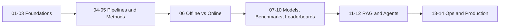

# LLM Evals — Notes Index

Each topic lives in its own file under [notes/](notes/). Read them in order or jump to any topic.

## Credits

These notes are based on the **LLM Evals** course by **[CampusX](https://www.youtube.com/@campusx-official)**. A big thank you to CampusX for the excellent content!

- Course playlist: <https://youtube.com/playlist?list=PLEneLIDJFpcA&si=0fbod9ua_-2Aufpa>

| # | Topic | File |
|---|---|---|
| 01 | LLM Evaluations (LLM Evals) — Short Notes | [01_intro_why_llm_evals.md](notes/01_intro_why_llm_evals.md) |
| 02 | LLM Evaluations — Notes (Part 2) | [02_types_model_vs_application_evals.md](notes/02_types_model_vs_application_evals.md) |
| 03 | LLM Evaluations — Part 3: Application Evaluation Workflow | [03_application_eval_workflow.md](notes/03_application_eval_workflow.md) |
| 04 | LLM Evals — Part 4: Evaluation Pipelines, Risk, and Methods | [04_eval_pipelines_and_risk.md](notes/04_eval_pipelines_and_risk.md) |
| 05 | LLM Evals — Part 4B: LLM Evaluation Methods | [05_eval_methods_programmatic_human_llm_judge.md](notes/05_eval_methods_programmatic_human_llm_judge.md) |
| 06 | LLM Evals — Part 5: Offline vs. Online Evaluation | [06_offline_vs_online_evals.md](notes/06_offline_vs_online_evals.md) |
| 07 | LLM Evaluations: Model Evals & Benchmarks | [07_model_evals_and_benchmarks.md](notes/07_model_evals_and_benchmarks.md) |
| 08 | Why LLMs Hallucinate: The Problem of Not Knowing What You Don't Know | [08_why_llms_hallucinate.md](notes/08_why_llms_hallucinate.md) |
| 09 | LLM Leaderboards — Types, Limitations, and How AI Engineers Should Read Them | [09_llm_leaderboards.md](notes/09_llm_leaderboards.md) |
| 10 | Running Custom LLM Model Evals — Text-to-SQL Case Study | [10_custom_model_evals_text_to_sql.md](notes/10_custom_model_evals_text_to_sql.md) |
| 11 | LLM Evals: RAG, Agents, and Application Evaluation | [11_rag_agents_three_tier_framework.md](notes/11_rag_agents_three_tier_framework.md) |
| 12 | LLM Evals — RAG Component, Pipeline, and Application Evaluation | [12_rag_component_pipeline_application_evals.md](notes/12_rag_component_pipeline_application_evals.md) |
| 13 | LLM Evals — Operational Evaluations | [13_operational_evals_latency_cost_reliability.md](notes/13_operational_evals_latency_cost_reliability.md) |
| 14 | LLM Evals: Online Evaluations & Continuous Production Monitoring | [14_online_evals_production_monitoring.md](notes/14_online_evals_production_monitoring.md) |

## Learning path

