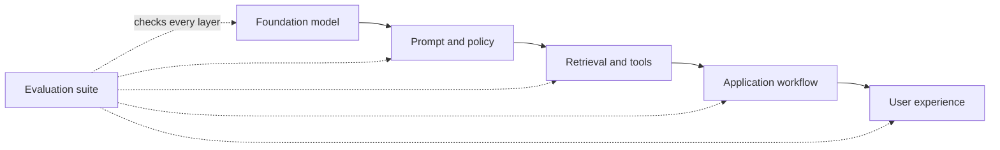
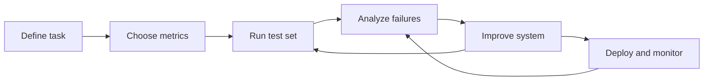
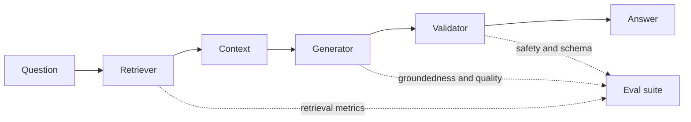
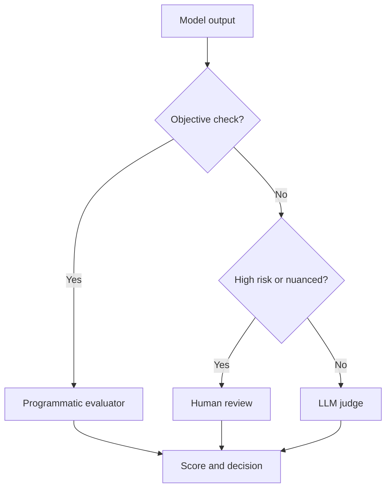

# LLM Evaluations (LLM Evals) — Short Notes

> **Numbering:** Sections are numbered continuously across Parts 1–4 so that references such as “Section 24” are unambiguous.

## 1. Moving Beyond Common Tools: Introducing LLM Evaluations
- **LLM evals** are structured tests used to measure an AI system’s quality, reliability, and safety.
- They help compare models, find failure patterns, and track improvements over time.

## 2. Two Major Career Advantages of Learning LLM Evals
- **Practical AI engineering:** Learn to test and improve AI features beyond making a working demo.
- **Career opportunities:** Build relevant skills for LLM engineering, AI quality assurance, evaluation, and AI safety roles.

## 3. The Problem with “Vibe Testing” Your AI
- **Vibe testing** means judging an AI system from a few casual prompts and subjective impressions.
- It misses edge cases and gives no reliable, repeatable performance measure.
- **Better approach:** Use test datasets, clear criteria, and repeatable evaluations.

## 4. Case Study 1: Air Canada’s Bereavement Refund Blunder
- The chatbot incorrectly said a customer could request a bereavement fare retroactively.
- In 2024, a Canadian tribunal held Air Canada responsible for the misleading information and ordered payment.
- **Lesson:** Verify policy answers against trusted sources, and evaluate high-impact customer-service responses.
- Source: [American Bar Association — Air Canada chatbot decision](https://www.americanbar.org/groups/business_law/resources/business-law-today/2024-february/bc-tribunal-confirms-companies-remain-liable-information-provided-ai-chatbot/)

## 5. Case Study 2: The “$1 Chevrolet Dealership” Jailbreak
- In 2023, a user manipulated a dealership chatbot into agreeing to sell a Chevrolet Tahoe for $1.
- The dealership did not honor the offer; the incident exposed weak instruction-following controls.
- **Lesson:** Test prompt injection and jailbreak attempts, and never let a chatbot make binding offers without safeguards.
- Source: [AIAAIC — Chevrolet chatbot incident](https://www.aiaaic.org/aiaaic-repository/ai-algorithmic-and-automation-incidents/driver-persuades-chatbot-to-sell-car-for-usd-1)

## 6. Case Study 3: Fake Legal Citations Generated by ChatGPT
- Lawyers submitted a legal brief containing fabricated cases and quotations generated by ChatGPT.
- The court imposed sanctions after the citations could not be verified.
- **Lesson:** In high-stakes work, verify every citation and factual claim against authoritative sources.
- Source: [Mata v. Avianca — court sanctions order](https://law.justia.com/cases/federal/district-courts/new-york/nysdce/1%3A2022cv01461/575368/54/)

## 7. Why Evaluating LLMs Is So Tricky
- Outputs can vary for the same prompt and may sound convincing while being wrong.
- Quality depends on context, task, user expectations, and risk level.
- A single score rarely captures the full picture; combine metrics with human review where needed.

## 8. Traditional Software Testing vs. Probabilistic LLM Evaluation
- **Traditional software:** Often checks whether fixed inputs produce expected outputs.
- **LLM systems:** Can produce many valid responses, so evaluation often checks criteria rather than exact wording.
- Use test cases, scoring rubrics, benchmarks, regression tests, and human review for ambiguous cases.

## 9. The Multi-Dimensional Check: Factuality, Tone, Groundedness, and Cost
- **Factuality:** Is the answer correct?
- **Tone:** Is the response appropriate for the audience and situation?
- **Groundedness:** Is the answer supported by the supplied context or sources?
- **Cost:** What are the latency, token, and money costs per task?
- Evaluate dimensions separately because strong performance on one does not guarantee strength on another.

## 10. Sneak Peek: RAG, Agent, Safety, and Operational Metrics
- **RAG evals:** Check retrieval relevance, context quality, and answer support.
- **Agent evals:** Check tool choice, action sequence, task completion, and recovery from errors.
- **Safety evals:** Test harmful requests, prompt injection, privacy, and policy compliance.
- **Operational metrics:** Track latency, cost, failure rate, and performance changes after updates.

-------------------
# LLM Evaluations — Notes (Part 2)

## 11. What Are LLM Evaluations?
LLM evaluations (evals) are systematic tests used to check how well a language model or AI application performs against defined requirements.

## 12. LLM Evals vs. Metrics
- **Eval:** The overall test or evaluation process.
- **Metric:** The measurement used to score a result.
- **Example:** Test whether an answer is grounded in a document (eval); calculate groundedness score (metric).

## 13. Types of LLM Evaluations
- **Offline:** Test a fixed dataset before release.
- **Online:** Evaluate real user interactions after deployment.
- **Human:** People judge quality, relevance, tone, or safety.
- **Automated:** Code, rules, or an LLM judge scores outputs.

## 14. Understanding Model Evaluations
Model evals measure a model's core abilities, such as reasoning, coding, knowledge, instruction-following, and safety. They often use curated datasets and standardized tests.

## 15. How AI Engineers Use Model Benchmarks
Benchmarks help engineers compare models on the same tasks, choose a model for a use case, track progress, and understand trade-offs. Benchmark scores may not predict performance on every real-world task.

## 16. Introduction to Application Evaluations
Application evals test the complete AI system—prompts, retrieval, tools, business logic, model output, and user experience—not just the underlying model.

## 17. Smartphone Analogy: Models vs. Applications
- **Model = processor:** Its capability matters, but it is only one component.
- **AI application = smartphone:** Overall performance also depends on software, memory, sensors, and design.
- A strong model can still produce a poor application if the surrounding system fails.

## 18. What Should We Evaluate in AI Applications?
- **Correctness:** Is the answer accurate and useful?
- **Groundedness:** Is it supported by the provided context or sources?
- **Instruction-following:** Did it meet the user's requirements?
- **Safety:** Does it avoid harmful or policy-violating output?
- **Reliability:** Does it perform consistently across cases?
- **Latency and cost:** Is it fast and affordable enough?
- **User experience:** Is the response clear and appropriately toned?

## 19. Model Evals vs. Application Evals: Recap
| Model Evals | Application Evals |
|---|---|
| Test the model's general capabilities | Test the complete AI product or workflow |
| Often use standard benchmarks | Use task-specific, real-world scenarios |
| Help select or compare models | Help validate and improve the shipped application |
| Focus on model-level strengths and weaknesses | Include retrieval, tools, prompts, safety, cost, and latency |

**Key takeaway:** Model evals tell you how capable a model is; application evals tell you how well your AI system works for its intended users.

**Example:** A model benchmark may show strong reasoning, but an application eval can still fail if the app retrieves the wrong policy document or formats the answer incorrectly.

---------------------------

# LLM Evaluations — Part 3: Application Evaluation Workflow

## 20. Recap: Why, What, and Types of LLM Evals
- **Why:** Detect errors, improve reliability, reduce risk, and track regressions.
- **What:** Tests that measure how well an LLM or AI application performs against defined expectations.
- **Types:** Model evaluations, application evaluations, human evaluations, automated evaluations, offline tests, and production monitoring.

## 21. Introduction to the LLM Application Evaluation Workflow
A repeatable cycle: **define → measure → test → analyze → improve → monitor**.

**Worked example:** For an email classifier, a release might require macro-F1 ≥ 0.90, JSON validity = 100%, and p95 latency ≤ 800 ms. A version that improves F1 but violates the latency limit is not ready to ship.

## 22. Example: Building an Email Classification LLM Application
Goal: Classify incoming emails into categories such as **work, personal, promotions, support, or spam**. The output should use an agreed label format.

## 23. Step 1: Define the Task and Target
- State exactly what the application must do.
- Define valid categories, output format, and how to handle unclear emails.

## 24. Step 2: Define Success Criteria and Metrics
Choose measurable goals, such as:
- **Accuracy:** Percentage of emails classified correctly.
- **Precision / Recall / F1:** Useful when classes are imbalanced or mistakes have different costs.
- **Latency and cost:** Time and expense per prediction.
- **Format validity:** Whether output follows the required schema.

## 25. Step 3: Build a Golden Evaluation Dataset
- Create representative examples with trusted, human-verified labels.
- Include common cases, edge cases, ambiguous emails, and every category.
- Keep evaluation examples separate from prompt-tuning examples where possible.

## 26. Step 4: Choose an Evaluation Method
- **Code-based:** Exact label match, schema checks, and standard metrics.
- **Human review:** People assess quality, ambiguity, and harmful errors.
- **LLM-as-a-judge:** Another model scores outputs using a fixed rubric; validate it against human judgments.

## 27. Step 5: Run the Model on the Evaluation Dataset
- Use the same dataset and settings to compare versions fairly.
- Save inputs, outputs, model/prompt versions, metrics, and errors.

## 28. Step 6: Evaluate and Analyze Results
- Compare results with the success criteria.
- Inspect a sample of failures and group them by cause, such as confusing categories, missing context, or invalid output.
- Check performance for each category, not just the overall score.

## 29. Step 7: Improve the System (Prompt and Model Optimization)
- Improve instructions, examples, output constraints, or preprocessing.
- Test alternative models when needed.
- Change one major factor at a time and re-run evaluations to measure its effect.

## 30. Step 8: Iterative Evaluation and Improvement Loop
Repeat **test → analyze → change → re-test**. Keep regression tests so new changes do not break previously successful cases.

## 31. Step 9: Deployment and Production Monitoring
- Deploy only after meeting release criteria.
- Monitor quality signals, latency, cost, failures, and user feedback.
- Use privacy-appropriate logging and alert on meaningful changes.

## 32. Handling Production Failures and Dataset Expansion
- Review failures and confirm their root causes.
- Add representative, verified examples to the golden dataset.
- Re-run the full evaluation suite before releasing fixes.
- Avoid adding unverified or sensitive production data without proper review and safeguards.

## 33. Why One LLM Application Needs Multiple Evaluations
One score cannot capture everything. A system can be accurate but slow, costly, poorly formatted, biased, or unsafe. Combine task quality, robustness, safety, latency, cost, and user-experience checks.

-----------------------

# LLM Evals — Part 4: Evaluation Pipelines, Risk, and Methods

## Part A — Application-Level Evaluation

### 34. Core Idea: Multiple Eval Pipelines
A reliable LLM app needs several evaluations at once: component checks, end-to-end workflow checks, safety checks, and operational monitoring. One score cannot capture every failure.

### 35. Anatomy of a RAG Setup
A typical Retrieval-Augmented Generation (RAG) pipeline is:
1. **Question** → 2. **Retriever** finds relevant chunks → 3. **Context** is assembled → 4. **LLM** generates an answer → 5. **Response** is checked and returned.

**Example:** If the answer cites a document that was never retrieved, the failure is in context assembly or citation handling—not necessarily in the model’s general knowledge.

### 36. Where Can an Application Fail?
- **Retrieval:** relevant evidence is missed or irrelevant chunks are retrieved.
- **Generation:** answer is incorrect, incomplete, or unsupported by context.
- **Workflow:** steps are misordered, inputs are lost, or tools are called incorrectly.
- **Safety:** sensitive data leaks or unsafe instructions are followed.
- **Operations:** latency, errors, or cost exceed limits.

### 37. Independent Success vs. Combined Failure
Each component can look good in isolation while the full system still fails. For example, retrieval may find useful chunks, but the generator may ignore them or misinterpret them. Evaluate both individual stages and the end-to-end result.

### 38. Scenario: The “8-Week ML Course Duration” Trap
A RAG system may retrieve a page mentioning an **8-week course**, yet answer incorrectly if it mixes that fact with another course or ignores qualifying details. Test whether the final answer is supported by the correct source and preserves the exact condition.

### 39. From Component Checks to Workflow Checks
- **Component-level:** Does the retriever find relevant chunks? Does the classifier label an email correctly?
- **Workflow-level:** Do retrieval, context assembly, generation, and validation work together in the right order?
- **Application-level:** Does the complete product satisfy the user’s goal safely, accurately, and efficiently?

### 40. Why Audit the Full Application?
Component metrics do not reveal every interaction failure. End-to-end audits verify that the complete system produces useful, grounded, safe results under realistic inputs.

### 41. Three Evaluation Levels — Recap
| Level | Main question | Example |
|---|---|---|
| Component | Does one part work? | Retriever Recall@K |
| Workflow | Do connected steps work together? | Retrieved context reaches the answer generator |
| Application | Does the whole product meet its goal? | User receives a correct, safe answer at acceptable cost |

### 42. Multi-Dimensional Risk Categories
Evaluate more than correctness. Consider **quality**, **safety**, and **operations**, then set acceptance thresholds for each.

### 43. The Three Pillars
- **Application quality:** correctness, relevance, completeness, groundedness, instruction following, and tone.
- **Safety:** toxicity, privacy/data leakage, prompt-injection and jailbreak resistance, and policy compliance.
- **Operations:** latency, throughput, availability, failure rate, and cost per request.

### 44. Useful Metrics by Application Type
- **Summarization:** factual consistency, coverage of key points, relevance, and conciseness.
- **RAG:** context precision/recall, answer correctness, faithfulness/groundedness, and citation quality.
- **Chatbots:** helpfulness, relevance, coherence, tone, task completion, and safe refusal when required.
- **Agents:** task success, correct tool selection/use, valid arguments, step efficiency, and recovery from tool errors.

### 45. Safety Guardrails Matrix
| Risk | Example check |
|---|---|
| Toxicity / harmful output | Test known risky prompts and score harmfulness |
| Sensitive-data leak | Ask for private data and verify it is not exposed |
| Jailbreak / prompt injection | Try instructions that conflict with system rules |
| Unsafe action | Verify that consequential actions require the correct checks or approval |

Use diverse adversarial cases, record failures, and re-run them after every meaningful change.

### 46. Operational Audits
- **Latency:** measure end-to-end response time, including percentiles such as p50 and p95/p99.
- **Load testing:** measure latency, errors, and throughput at expected and peak traffic.
- **Cost per request:** total model, retrieval, tool, and infrastructure cost divided by completed requests.
- Monitor all three over time; averages alone can hide slow tail requests or occasional expensive calls.

---

## Part B — LLM Evaluation Methods

### 47. What Is an Evaluation Method?
An eval method is the mechanism used to judge an output against a criterion, such as an exact expected answer, a human rubric, or a model-generated score.

### 48. Three Core Execution Styles
1. **Programmatic/deterministic:** rules, exact matches, calculations, or known labels.
2. **Human-based:** people judge quality using a rubric or comparative preference.
3. **Model-graded:** another LLM scores the output against explicit criteria.

These methods can be combined in one evaluation pipeline.

**Rule of thumb:** Use code for exact labels and schemas, humans for high-stakes nuance, and an LLM judge for scalable open-ended checks after calibration.

### 49. Example: Zomato Email Classifier
Task: classify incoming emails into labels such as **order issue**, **refund**, **delivery**, or **general query**. Create labeled examples, run the classifier, then compare predictions with expected labels using accuracy, precision, recall, and F1. Add human review for ambiguous or high-impact cases.

### 50. Method 1 — Programmatic / Deterministic Evaluation
Best when the answer or rules can be checked objectively. Examples: exact label match, JSON schema validity, required fields present, correct tool name, or numeric tolerance. It is fast and repeatable, but does not fully measure subjective qualities such as helpfulness.

### 51. Retriever Evaluation and Recall@K
**Recall@K** measures how many relevant documents appear in the top *K* retrieved results.

\[
\text{Recall@K} = \frac{\text{Relevant items in top K}}{\text{Total relevant items for the query}}
\]

**Example:** If a query has 4 relevant chunks and the top 5 results contain 3 of them, Recall@5 = 3/4 = **0.75 (75%)**.

### 52. Improving the Retriever
Test embedding models, chunk size/overlap, metadata filters, query rewriting, and different values of **K**. Measure retrieval quality and final answer quality together: increasing K may add useful evidence, but can also introduce noise, latency, and cost.

### 53. Method 2 — Human-Based Evaluation
People review outputs when quality depends on context, nuance, or user preference. Use clear instructions, representative cases, a consistent rubric, and examples of each score level.

### 54. A 1–5 Helpfulness Rubric
- **1:** Incorrect or not useful.
- **2:** Mostly misses the user’s need.
- **3:** Partly useful, with notable gaps.
- **4:** Helpful and mostly complete, with minor issues.
- **5:** Accurate, relevant, complete, and directly useful.

Define the scale before grading so different reviewers interpret scores consistently.

### 55. Multiple Graders and Disagreement
Use multiple graders for subjective or high-stakes cases. Compare score distributions and agreement, discuss ambiguous examples, and revise the rubric. Disagreement can signal unclear criteria—not merely a poor grader.

### 56. Common Human-Eval Styles
- **Rubric grading:** score each response against defined criteria.
- **Pairwise preference / A–B testing:** choose which of two outputs is better.
- **Expert review:** specialists judge domain-specific correctness.
- **Red teaming:** intentionally probe for unsafe or exploitable behavior.
- **User feedback / usability review:** collect real-world satisfaction and task-completion signals.

These are common approaches, not a universal fixed taxonomy.

### 57. Quality vs. Cost in Human Evals
Human review is valuable for nuance but can be slow and costly. Prioritize expert review for risky cases, sample routine cases, and use automated checks for straightforward criteria. Calibrate human reviewers before scaling.

### 58. Method 3 — Model-Graded Evaluation (LLM as Judge)
A judge LLM assesses a candidate answer against a rubric. It scales well for open-ended outputs, but can be biased by wording, answer length, position, or its own model limitations. Validate judge scores against human judgments.

### 59. Case Study: UPSC Mains Answer Evaluation
A judge can score a written answer on dimensions such as factual accuracy, relevance to the question, structure, analysis, examples, and conclusion. Specify the maximum marks and criteria for each dimension; the judge should not award marks for unsupported claims or content unrelated to the prompt.

### 60. Designing a Strong Judge Rubric
Include:
- The question and candidate answer.
- Explicit criteria and maximum marks per criterion.
- What earns full, partial, or zero marks.
- Constraints against rewarding irrelevant or fabricated content.
- A structured output schema, such as criterion scores, total score, and brief evidence-based explanation.

Treat judge “reasoning” as an explanation to inspect, not proof that its score is correct.

### 61. Human vs. LLM Scores
Score the same sample with humans and the LLM judge. Compare average scores, rank ordering, disagreement cases, and the judge’s consistency. Review mismatches before trusting the judge at scale.

### 62. Measuring Judge Error with MAE
Mean Absolute Error (MAE) measures the average absolute difference between judge scores and reference human scores.

\[
\text{MAE} = \frac{1}{n}\sum_{i=1}^{n}|J_i-H_i|
\]

**Example:** Human scores = [4, 5, 3], judge scores = [3, 4, 4]. Absolute errors = [1, 1, 1], so MAE = **1.0 point**. Lower MAE means closer scores, but does not alone guarantee fair or reliable judgments.

### 63. Reference-Based vs. Reference-Free Evals
- **Reference-based:** compares output with a known answer, label, or source. Useful for classification and tasks with trustworthy targets.
- **Reference-free:** evaluates using criteria without one single gold answer, often with a rubric or judge. Useful for open-ended responses, but needs careful calibration.

Some evaluations use both references and rubric-based checks.

### 64. Offline vs. Online Evaluation
- **Offline evals:** run a fixed dataset before release or after a change; controlled and reproducible.
- **Online evals:** monitor real production traffic using feedback, sampled reviews, error rates, safety signals, latency, and cost.
- **Loop:** production failures → curated test cases → offline regression suite → improvements → monitored deployment.

### 65. Production-Grade Mindset — Final Checklist
- Define measurable success criteria before tuning.
- Keep a versioned golden dataset and add real failure cases.
- Evaluate components, workflows, and the full application.
- Combine programmatic checks, human review, and model judges where appropriate.
- Track quality, safety, latency, and cost together.
- Re-run regression tests after each significant change and monitor after deployment.
