# LLM Evals — Interview Questions (Beginner → Advanced)

> Built from notes 01–14. Each answer is written so you can say it in an interview in about 1–2 minutes. Diagrams are included where they make the answer clearer.

**Levels:** 🟢 Beginner (Q1–Q8) · 🟡 Intermediate (Q9–Q18) · 🔴 Advanced (Q19–Q28)

---

## 🟢 Beginner

### Q1. What are LLM evals, and why do we need them?

**Answer:** LLM evals are structured, repeatable tests that measure an LLM or LLM application on quality, reliability, safety, and cost. We need them because LLM outputs are probabilistic: a prompt or model change can fix one case and quietly break ten others. Without evals, teams rely on "vibe testing", which means trying a few prompts by hand and shipping. Real incidents show the risk: Air Canada's chatbot invented a refund policy, a car dealership's bot agreed to sell a Chevrolet for $1, and lawyers submitted fake case citations generated by ChatGPT.

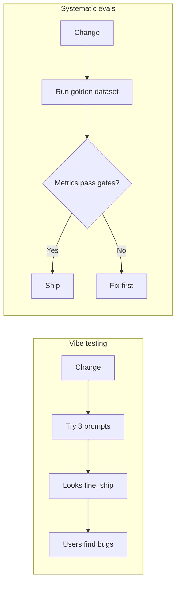

### Q2. How is testing an LLM different from traditional software testing?

**Answer:** Traditional tests are deterministic: the same input gives the same output, so `assert output == expected` works. LLMs can give many valid answers to the same input, and the same answer can vary between runs. So instead of exact equality we use **metrics, rubrics, and thresholds** (for example, "faithfulness ≥ 0.85"). We also run on datasets rather than single cases, and we judge several things at once: correctness, groundedness, tone, safety, latency, and cost.

### Q3. What is the difference between an eval and a metric?

**Answer:** A **metric** is a single measurement, such as accuracy, faithfulness, or p95 latency. An **eval** is the whole test procedure: a dataset, the system under test, one or more metrics, a scoring method, and pass/fail thresholds. Put simply, a metric is one ruler, and an eval is the full exam that uses several rulers.

### Q4. Model evals vs. application evals?

**Answer:** **Model evals** measure a base model's general capabilities on standard benchmarks (MMLU, GSM8K, HumanEval). They help you *choose* a model. **Application evals** measure the whole product (prompts, retrieval, tools, guardrails, and model together) on your own data and tasks. Analogy: the model is the phone's processor, and the application is the full phone. Users judge the phone, not the chip.

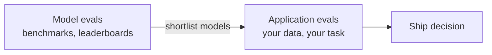

### Q5. What is a golden dataset?

**Answer:** A curated, versioned set of inputs with human-verified expected outputs (or expected facts or behaviour). It is the "answer key" for offline evaluation and regression testing. A good one covers common cases, edge cases, ambiguous and unanswerable questions, adversarial inputs, and real production failures. It must itself be validated, because a wrong gold answer makes the whole eval untrustworthy.

### Q6. What are the three main evaluation methods?

**Answer:**
1. **Programmatic / deterministic:** code checks such as exact match, regex, JSON schema validity, SQL execution, or F1 against labels. Cheap, fast, and objective.
2. **Human evaluation:** people score outputs with a rubric or compare two outputs. The best quality, but slow and expensive.
3. **LLM-as-a-judge:** another LLM scores outputs against explicit criteria. Scalable for open-ended text, but it must be calibrated against humans.

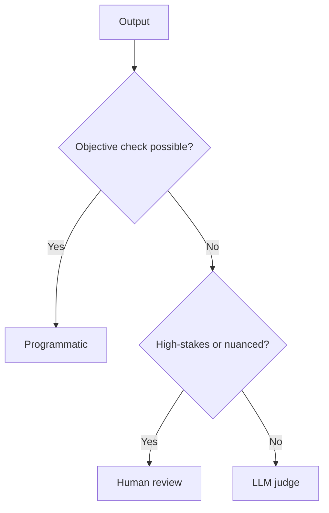

### Q7. What is offline vs. online evaluation?

**Answer:** **Offline** evals run *before release* on a curated dataset. They answer "Is this version good enough to ship?" **Online** evals run *after deployment* on (sampled) production traces. They answer "Is it behaving well for real users right now?" Offline supports release gates and regression tests. Online catches drift, new failure patterns, safety incidents, and cost spikes. You need both.

### Q8. What is regression testing in LLM apps?

**Answer:** Re-running the same golden dataset after any change (prompt, model, retriever, embeddings, code) and comparing against the baseline, to make sure previously working behaviour has not got worse. It is usually automated in CI with release gates.

---

## 🟡 Intermediate

### Q9. Walk me through the LLM application evaluation workflow.

**Answer:** Define the task → define success criteria and metrics → build a golden dataset → choose eval methods → run the system → analyse failures → improve the prompt, model, or retrieval → re-evaluate → deploy and monitor → feed production failures back into the dataset.

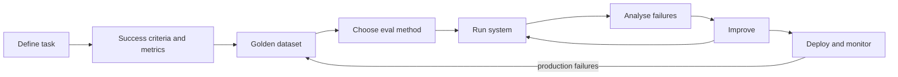

Example: for an email classifier, the release criteria could be macro-F1 ≥ 0.90, 100% valid JSON, and p95 latency ≤ 800 ms. A version that improves F1 but breaks the latency limit does **not** ship.

### Q10. What are the main components of a RAG system, and where can each fail?

**Answer:**

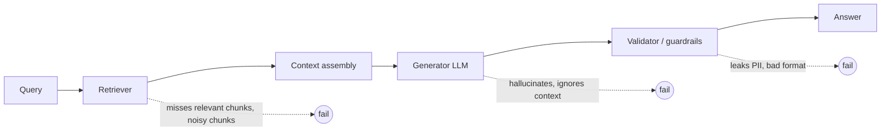

- **Retrieval:** misses relevant evidence or returns irrelevant chunks.
- **Generation:** an answer that is wrong, incomplete, or unsupported by the context.
- **Workflow:** wrong step order, or a lost input.
- **Safety:** PII leakage, prompt injection.
- **Operations:** latency, cost, errors.

### Q11. Explain the RAG triad.

**Answer:** Three checks that together cover a RAG pipeline:
1. **Context relevance:** is the retrieved context relevant to the query? (retriever quality)
2. **Faithfulness / groundedness:** is every claim in the answer supported by the context? (catches hallucination)
3. **Answer relevance:** does the answer actually address the question?

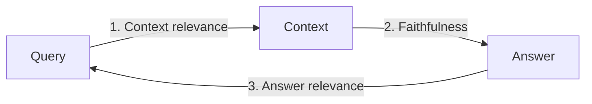

If faithfulness is high but correctness is low, the retriever probably fetched the wrong documents, so fix retrieval rather than the prompt.

### Q12. How do you evaluate the retriever on its own?

**Answer:** Use labelled query → relevant-chunk pairs and compute:
- **Recall@K:** the share of relevant chunks that appear in the top K. *Did we find the evidence?*
- **Precision@K / contextual precision:** the share of the top K that is relevant, and whether relevant chunks are ranked first.
- **MRR / nDCG:** ranking quality.

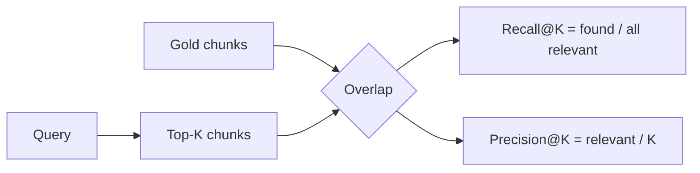

To improve the scores, change the chunking strategy, the embedding model, or use hybrid (BM25 + vector) search, a reranker, or query rewriting.

### Q13. How does a faithfulness metric work internally (for example, in DeepEval or Ragas)?

**Answer:** It is claim-based. An LLM first extracts the individual claims from the answer. Then it checks each claim against the retrieved context (supported, contradicted, or not found). The score is supported claims divided by total claims.

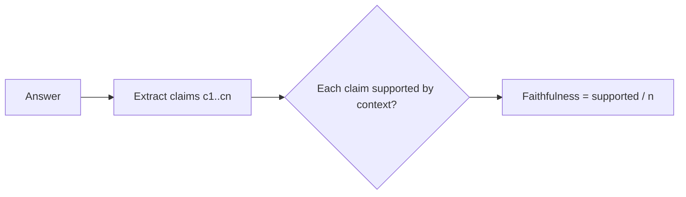

### Q14. What is LLM-as-a-judge, and how do you design a good judge?

**Answer:** You use a strong LLM to score outputs against a rubric. Good practice:
- A **clear rubric** with defined score levels (for example, 1–5 with descriptions and examples).
- Ask for **reasoning before the score**, and use structured output (JSON).
- Judge **one criterion at a time**.
- For pairwise comparisons, **swap the order** of the two answers to reduce position bias.
- Use a different, ideally stronger, model than the one being judged, to reduce self-preference.
- **Calibrate against humans** before trusting the judge at scale.

### Q15. How do you know your LLM judge is reliable?

**Answer:** Have humans score a sample, have the judge score the same sample, and measure the agreement: **MAE** (mean absolute error) for numeric scores, or Cohen's kappa / percent agreement for labels. If the error is too high, refine the rubric or the prompt and repeat.

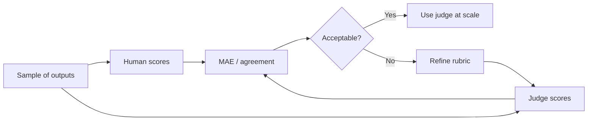

Example: human scores [4, 2, 5] and judge scores [3, 2, 4] give MAE = (1 + 0 + 1) / 3 ≈ 0.67.

### Q16. Reference-based vs. reference-free evaluation?

**Answer:** **Reference-based** evals compare the output to a known expected answer (exact match, answer correctness, SQL result match). They are only possible offline, where gold answers exist. **Reference-free** evals judge the output on criteria or context without a gold answer (faithfulness to retrieved context, relevance, toxicity, tone). This is why online evals in production are mostly reference-free: real users' questions have no answer key.

### Q17. Which operational metrics do you track?

**Answer:**
- **Latency:** P50, P95, and P99 (not the average, because it hides slow requests). For streaming, **TTFT** (time to first token). Also measure each component: embedding, vector DB, reranker, LLM.
- **Cost:** input and output tokens, cost per request, and especially **cost per successful task**.
- **Reliability:** error rate, timeouts, retries, rate-limit hits, and schema-validation failures.

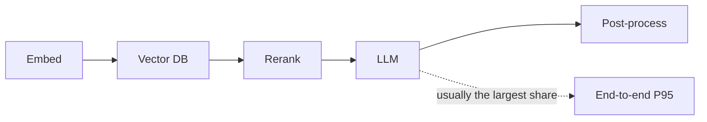

### Q18. What safety evaluations would you run?

**Answer:** Prompt injection and jailbreak resistance, PII leakage, toxicity and bias, refusal quality (refuses harmful requests but doesn't over-refuse safe ones), hallucinated policies or claims, and access control (a user can't retrieve documents they are not allowed to see). Use red-team datasets offline and toxicity or PII classifiers online. Any critical safety failure should block release.

---

## 🔴 Advanced

### Q19. "How would you evaluate a RAG chatbot end-to-end?" (the classic question)

**Answer:** Use a three-tier framework:
1. **Component level:** retriever (contextual precision, recall, relevancy) and generator (faithfulness, answer relevancy).
2. **Pipeline level:** the RAG triad end to end, plus task success.
3. **Application level:** correctness, completeness, tone, abstaining on unanswerable questions, safety, latency, and cost.

Then add a golden dataset with edge and adversarial cases, CI regression gates, online sampling of production traces, and a feedback loop.

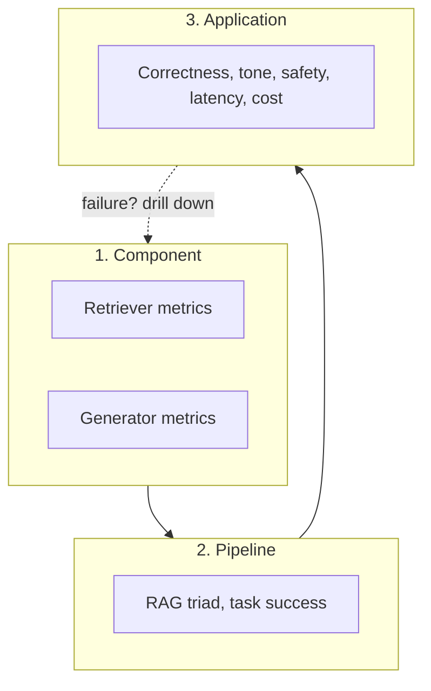

Key point: an overall score tells you *that* it failed. Component scores tell you *where*.

### Q20. Each component scores well, but the app still fails. Why, and what do you do?

**Answer:** Failures can come from how components **interact**. For example, the retriever finds the right chunk, but the generator ignores it or mixes it up with a similar chunk. In the course's "8-week ML course" trap, the right information was retrieved, but the answer combined it with another course's duration. Fix: add **pipeline-level and application-level** evals, trace the full request to see where the information was lost, and add the failing case to the golden dataset.

### Q21. Design an online evaluation system for production.

**Answer:**

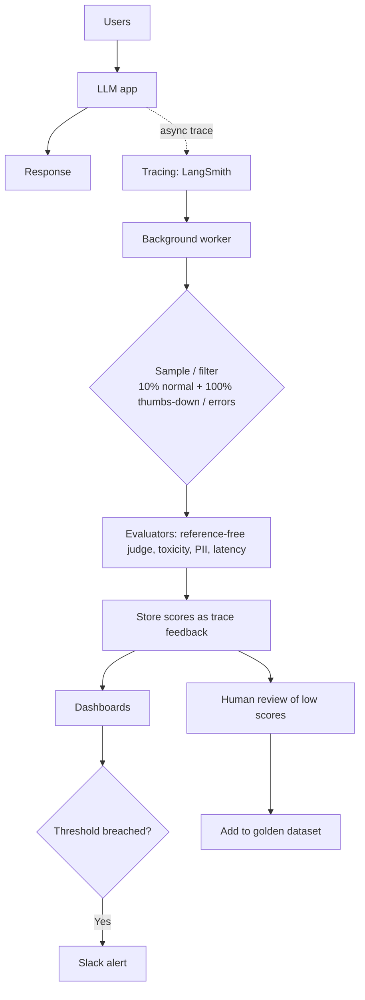

Key design choices:
- Evaluate **asynchronously** so users never wait for the judge.
- **Sample** to control cost.
- Use the **same metric definitions** offline and online, so the scores can be compared.
- **Redact PII** before storing traces.
- Alert on trends, not on single noisy scores.

### Q22. Why sample traces instead of evaluating all of them? What are the risks?

**Answer:** Running an LLM judge on every request multiplies cost and load. Random sampling (for example, 10%) gives statistically useful trends cheaply. The risk is that rare, high-impact failures can slip through. So combine random sampling with **targeted** filters: 100% of errors, negative feedback, low-confidence answers, high-risk routes, and safety classifiers on all traffic (they are cheap).

### Q23. How do you choose a model for a new use case (for example, Text-to-SQL)?

**Answer:**

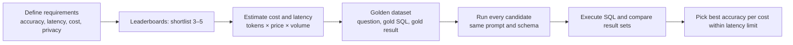

Compare **execution results**, not SQL strings: two different queries can both be correct. Handle row order (only compare it when the question requires order), NULLs, and floating-point tolerance. Keep a hold-out set for the final check.

### Q24. Why can't we fully trust leaderboards and benchmarks?

**Answer:**
- **Data contamination:** test questions leak into the training data.
- **Saturation:** top models all score above 90%, so the benchmark no longer separates them (which is why MMLU-Pro, GPQA, and HLE exist).
- **Configuration gaming:** different prompts, few-shot examples, or retries between models.
- **Misleading aggregation:** one average hides weak categories.
- **No uncertainty or cost reported.**
- **Static tests** don't match real conditions.
- **Human-preference arenas** reward style and length.

Use leaderboards to **shortlist**, then decide with your own evals.

### Q25. Explain Pass@1, Pass@k, and Majority@k.

**Answer:**
- **Pass@1:** the share of problems solved on the first attempt.
- **Pass@k:** the share solved by *at least one* of k attempts. It measures capability given retries, as used in HumanEval coding tests.
- **Majority@k:** sample k answers and take the most common one. It measures self-consistency.

Always report k and the sampling temperature, because Pass@10 can look much better than Pass@1.

### Q26. Why do LLMs hallucinate, and how do evals connect to it?

**Answer:** LLMs predict the next plausible token and have no built-in concept of truth. Training and benchmarks **reward guessing**: a lucky guess scores points, while "I don't know" scores zero. Interpretability research (Anthropic) shows the model has a default "can't answer" circuit that is *suppressed* by a "known entity" feature. That feature fires on familiarity, not actual knowledge, which produces confident hallucinations.

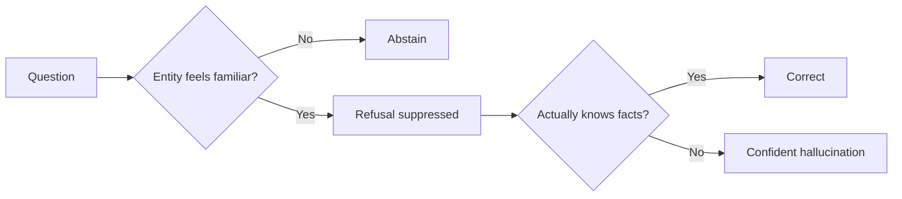

**Eval implication:** give credit for appropriate abstention, include unanswerable questions in the golden set, and measure faithfulness to context.

### Q27. How do you set up CI/CD regression gates for an LLM app?

**Answer:**

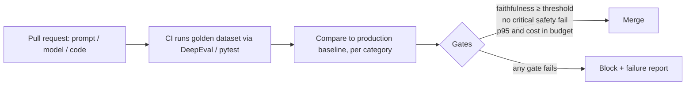

Tips:
- Run LLM-judged metrics several times, or use a tolerance band, because judges are noisy.
- Gate **per category** so averages don't hide regressions.
- Keep a fast smoke subset for every PR and the full suite nightly.
- Version the dataset, prompts, and judge model.

### Q28. How do you build a self-improving evaluation loop (the "data flywheel")?

**Answer:**

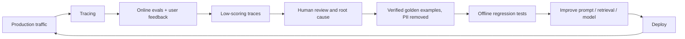

Important: the system does **not** improve automatically. A human must verify each failure before it becomes a golden example (never treat an unverified judge opinion as ground truth), and every fix must pass regression tests before it is deployed.

---

## ⚡ Rapid-fire (one-liners)

| Question | Answer |
|---|---|
| Why use P95 rather than average latency? | The average hides the slow tail that users actually feel. |
| What is TTFT? | Time to first token, the latency users perceive with streaming. |
| DeepEval vs. Ragas? | Both offer RAG metrics. DeepEval is pytest-style with CI integration and many built-in metrics. Ragas is focused on RAG metrics. |
| What does LangSmith do? | Tracing, datasets and experiments, online evaluators, monitoring. |
| What is benchmark contamination? | Test data leaked into training, which inflates scores. |
| How do you reduce LLM-judge position bias? | Swap the order of the answers and average. |
| Cost metric that matters most? | Cost per *successful* task. |
| What do you do with a production failure? | Verify it, anonymise it, add it to the golden set, fix, run regression tests. |
