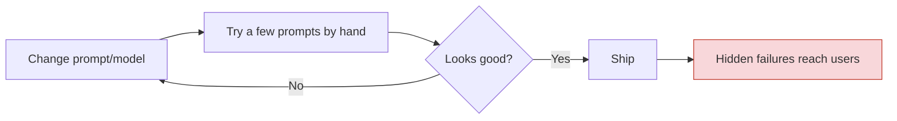
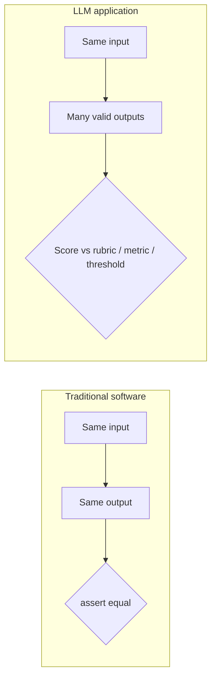
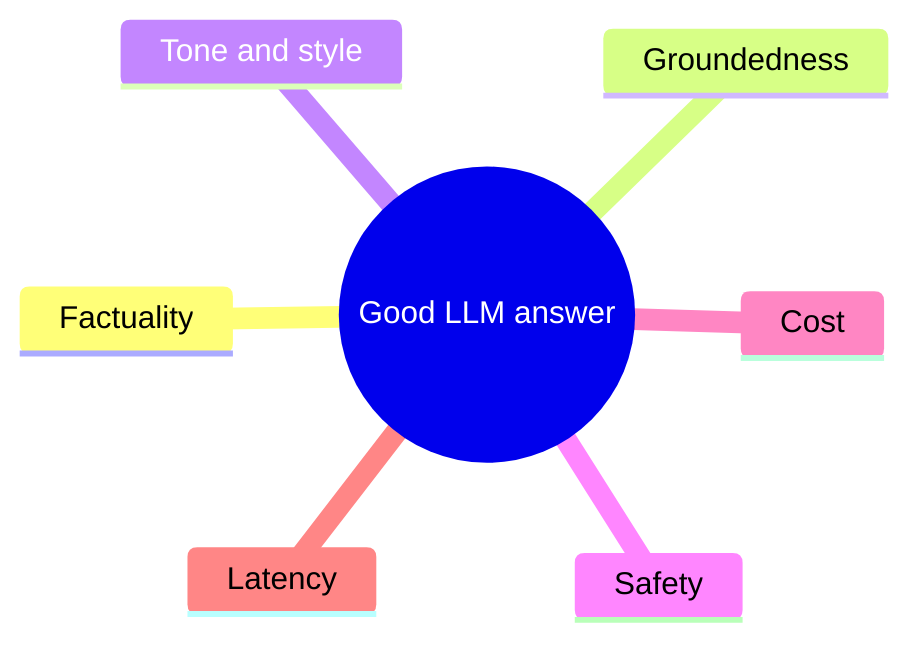

# LLM Evaluations (LLM Evals) — Short Notes

> **Numbering:** Sections are numbered continuously across Parts 1–4 so that references such as “Section 24” are unambiguous.

## 1. Moving Beyond Common Tools: Introducing LLM Evaluations
- **LLM evals** are structured tests used to measure an AI system’s quality, reliability, and safety.
- They help compare models, find failure patterns, and track improvements over time.

## 2. Two Major Career Advantages of Learning LLM Evals
- **Practical AI engineering:** Learn to test and improve AI features beyond making a working demo.
- **Career opportunities:** Build relevant skills for LLM engineering, AI quality assurance, evaluation, and AI safety roles.

## 3. The Problem with “Vibe Testing” Your AI
- **Vibe testing** means judging an AI system from a few casual prompts and subjective impressions.
- It misses edge cases and gives no reliable, repeatable performance measure.
- **Better approach:** Use test datasets, clear criteria, and repeatable evaluations.

## 4. Case Study 1: Air Canada’s Bereavement Refund Blunder
- The chatbot incorrectly said a customer could request a bereavement fare retroactively.
- In 2024, a Canadian tribunal held Air Canada responsible for the misleading information and ordered payment.
- **Lesson:** Verify policy answers against trusted sources, and evaluate high-impact customer-service responses.
- Source: [American Bar Association — Air Canada chatbot decision](https://www.americanbar.org/groups/business_law/resources/business-law-today/2024-february/bc-tribunal-confirms-companies-remain-liable-information-provided-ai-chatbot/)

## 5. Case Study 2: The “$1 Chevrolet Dealership” Jailbreak
- In 2023, a user manipulated a dealership chatbot into agreeing to sell a Chevrolet Tahoe for $1.
- The dealership did not honor the offer; the incident exposed weak instruction-following controls.
- **Lesson:** Test prompt injection and jailbreak attempts, and never let a chatbot make binding offers without safeguards.
- Source: [AIAAIC — Chevrolet chatbot incident](https://www.aiaaic.org/aiaaic-repository/ai-algorithmic-and-automation-incidents/driver-persuades-chatbot-to-sell-car-for-usd-1)

## 6. Case Study 3: Fake Legal Citations Generated by ChatGPT
- Lawyers submitted a legal brief containing fabricated cases and quotations generated by ChatGPT.
- The court imposed sanctions after the citations could not be verified.
- **Lesson:** In high-stakes work, verify every citation and factual claim against authoritative sources.
- Source: [Mata v. Avianca — court sanctions order](https://law.justia.com/cases/federal/district-courts/new-york/nysdce/1%3A2022cv01461/575368/54/)

## 7. Why Evaluating LLMs Is So Tricky
- Outputs can vary for the same prompt and may sound convincing while being wrong.
- Quality depends on context, task, user expectations, and risk level.
- A single score rarely captures the full picture; combine metrics with human review where needed.

## 8. Traditional Software Testing vs. Probabilistic LLM Evaluation
- **Traditional software:** Often checks whether fixed inputs produce expected outputs.
- **LLM systems:** Can produce many valid responses, so evaluation often checks criteria rather than exact wording.
- Use test cases, scoring rubrics, benchmarks, regression tests, and human review for ambiguous cases.

## 9. The Multi-Dimensional Check: Factuality, Tone, Groundedness, and Cost
- **Factuality:** Is the answer correct?
- **Tone:** Is the response appropriate for the audience and situation?
- **Groundedness:** Is the answer supported by the supplied context or sources?
- **Cost:** What are the latency, token, and money costs per task?
- Evaluate dimensions separately because strong performance on one does not guarantee strength on another.

## 10. Sneak Peek: RAG, Agent, Safety, and Operational Metrics
- **RAG evals:** Check retrieval relevance, context quality, and answer support.
- **Agent evals:** Check tool choice, action sequence, task completion, and recovery from errors.
- **Safety evals:** Test harmful requests, prompt injection, privacy, and policy compliance.
- **Operational metrics:** Track latency, cost, failure rate, and performance changes after updates.

