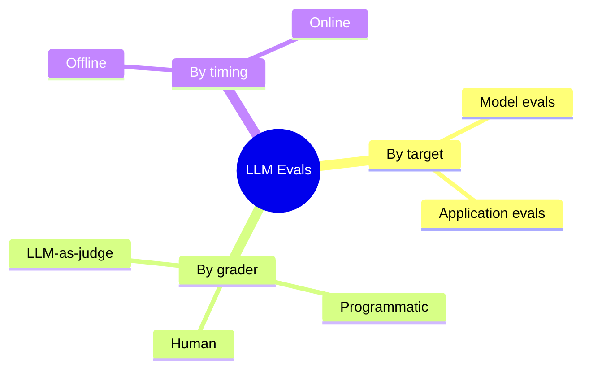
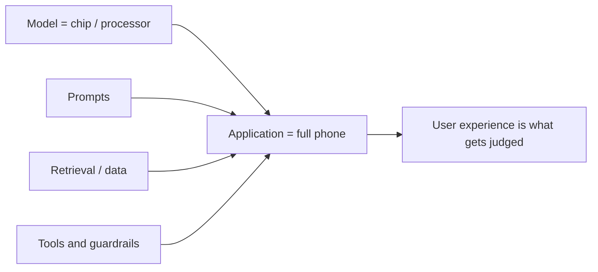
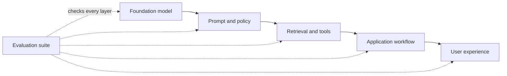

# LLM Evaluations — Notes (Part 2)

## 11. What Are LLM Evaluations?
LLM evaluations (evals) are systematic tests used to check how well a language model or AI application performs against defined requirements.

## 12. LLM Evals vs. Metrics
- **Eval:** The overall test or evaluation process.
- **Metric:** The measurement used to score a result.
- **Example:** Test whether an answer is grounded in a document (eval); calculate groundedness score (metric).

## 13. Types of LLM Evaluations
- **Offline:** Test a fixed dataset before release.
- **Online:** Evaluate real user interactions after deployment.
- **Human:** People judge quality, relevance, tone, or safety.
- **Automated:** Code, rules, or an LLM judge scores outputs.

## 14. Understanding Model Evaluations
Model evals measure a model's core abilities, such as reasoning, coding, knowledge, instruction-following, and safety. They often use curated datasets and standardized tests.

## 15. How AI Engineers Use Model Benchmarks
Benchmarks help engineers compare models on the same tasks, choose a model for a use case, track progress, and understand trade-offs. Benchmark scores may not predict performance on every real-world task.

## 16. Introduction to Application Evaluations
Application evals test the complete AI system—prompts, retrieval, tools, business logic, model output, and user experience—not just the underlying model.

## 17. Smartphone Analogy: Models vs. Applications
- **Model = processor:** Its capability matters, but it is only one component.
- **AI application = smartphone:** Overall performance also depends on software, memory, sensors, and design.
- A strong model can still produce a poor application if the surrounding system fails.

## 18. What Should We Evaluate in AI Applications?
- **Correctness:** Is the answer accurate and useful?
- **Groundedness:** Is it supported by the provided context or sources?
- **Instruction-following:** Did it meet the user's requirements?
- **Safety:** Does it avoid harmful or policy-violating output?
- **Reliability:** Does it perform consistently across cases?
- **Latency and cost:** Is it fast and affordable enough?
- **User experience:** Is the response clear and appropriately toned?

## 19. Model Evals vs. Application Evals: Recap
| Model Evals | Application Evals |
|---|---|
| Test the model's general capabilities | Test the complete AI product or workflow |
| Often use standard benchmarks | Use task-specific, real-world scenarios |
| Help select or compare models | Help validate and improve the shipped application |
| Focus on model-level strengths and weaknesses | Include retrieval, tools, prompts, safety, cost, and latency |

**Key takeaway:** Model evals tell you how capable a model is; application evals tell you how well your AI system works for its intended users.

**Example:** A model benchmark may show strong reasoning, but an application eval can still fail if the app retrieves the wrong policy document or formats the answer incorrectly.

