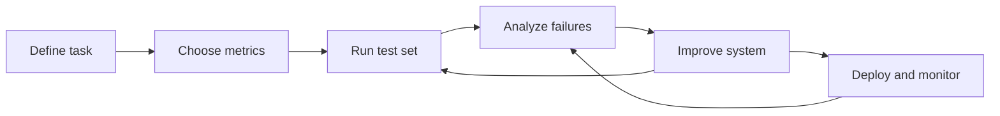
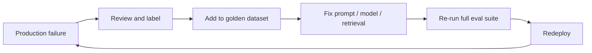

# LLM Evaluations — Part 3: Application Evaluation Workflow

## 20. Recap: Why, What, and Types of LLM Evals
- **Why:** Detect errors, improve reliability, reduce risk, and track regressions.
- **What:** Tests that measure how well an LLM or AI application performs against defined expectations.
- **Types:** Model evaluations, application evaluations, human evaluations, automated evaluations, offline tests, and production monitoring.

## 21. Introduction to the LLM Application Evaluation Workflow
A repeatable cycle: **define → measure → test → analyze → improve → monitor**.

**Worked example:** For an email classifier, a release might require macro-F1 ≥ 0.90, JSON validity = 100%, and p95 latency ≤ 800 ms. A version that improves F1 but violates the latency limit is not ready to ship.

## 22. Example: Building an Email Classification LLM Application
Goal: Classify incoming emails into categories such as **work, personal, promotions, support, or spam**. The output should use an agreed label format.

## 23. Step 1: Define the Task and Target
- State exactly what the application must do.
- Define valid categories, output format, and how to handle unclear emails.

## 24. Step 2: Define Success Criteria and Metrics
Choose measurable goals, such as:
- **Accuracy:** Percentage of emails classified correctly.
- **Precision / Recall / F1:** Useful when classes are imbalanced or mistakes have different costs.
- **Latency and cost:** Time and expense per prediction.
- **Format validity:** Whether output follows the required schema.

## 25. Step 3: Build a Golden Evaluation Dataset
- Create representative examples with trusted, human-verified labels.
- Include common cases, edge cases, ambiguous emails, and every category.
- Keep evaluation examples separate from prompt-tuning examples where possible.

## 26. Step 4: Choose an Evaluation Method
- **Code-based:** Exact label match, schema checks, and standard metrics.
- **Human review:** People assess quality, ambiguity, and harmful errors.
- **LLM-as-a-judge:** Another model scores outputs using a fixed rubric; validate it against human judgments.

## 27. Step 5: Run the Model on the Evaluation Dataset
- Use the same dataset and settings to compare versions fairly.
- Save inputs, outputs, model/prompt versions, metrics, and errors.

## 28. Step 6: Evaluate and Analyze Results
- Compare results with the success criteria.
- Inspect a sample of failures and group them by cause, such as confusing categories, missing context, or invalid output.
- Check performance for each category, not just the overall score.

## 29. Step 7: Improve the System (Prompt and Model Optimization)
- Improve instructions, examples, output constraints, or preprocessing.
- Test alternative models when needed.
- Change one major factor at a time and re-run evaluations to measure its effect.

## 30. Step 8: Iterative Evaluation and Improvement Loop
Repeat **test → analyze → change → re-test**. Keep regression tests so new changes do not break previously successful cases.

## 31. Step 9: Deployment and Production Monitoring
- Deploy only after meeting release criteria.
- Monitor quality signals, latency, cost, failures, and user feedback.
- Use privacy-appropriate logging and alert on meaningful changes.

## 32. Handling Production Failures and Dataset Expansion
- Review failures and confirm their root causes.
- Add representative, verified examples to the golden dataset.
- Re-run the full evaluation suite before releasing fixes.
- Avoid adding unverified or sensitive production data without proper review and safeguards.

## 33. Why One LLM Application Needs Multiple Evaluations
One score cannot capture everything. A system can be accurate but slow, costly, poorly formatted, biased, or unsafe. Combine task quality, robustness, safety, latency, cost, and user-experience checks.

