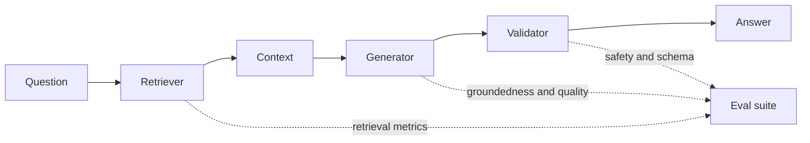
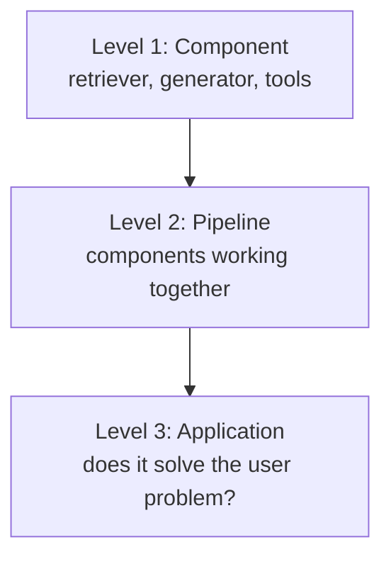
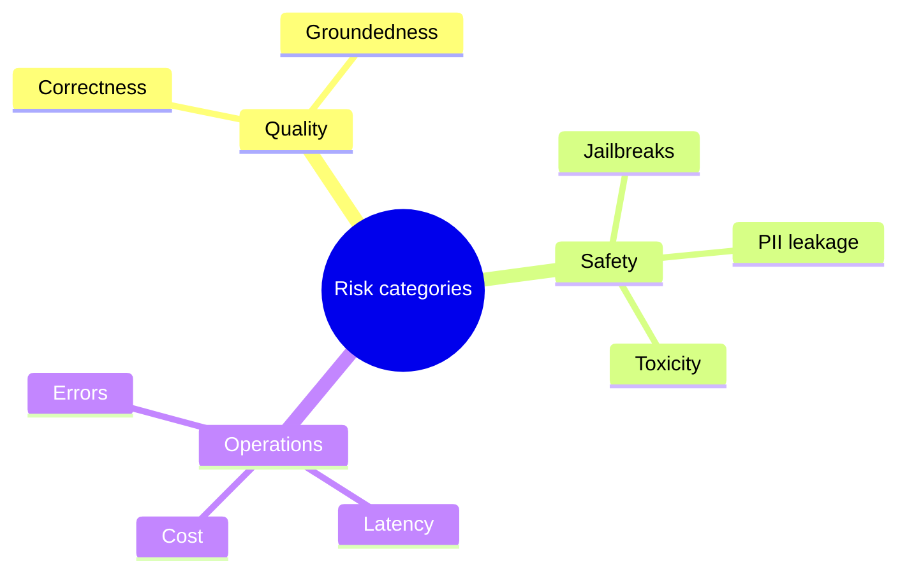

# LLM Evals — Part 4: Evaluation Pipelines, Risk, and Methods

## Part A — Application-Level Evaluation

### 34. Core Idea: Multiple Eval Pipelines
A reliable LLM app needs several evaluations at once: component checks, end-to-end workflow checks, safety checks, and operational monitoring. One score cannot capture every failure.

### 35. Anatomy of a RAG Setup
A typical Retrieval-Augmented Generation (RAG) pipeline is:
1. **Question** → 2. **Retriever** finds relevant chunks → 3. **Context** is assembled → 4. **LLM** generates an answer → 5. **Response** is checked and returned.

**Example:** If the answer cites a document that was never retrieved, the failure is in context assembly or citation handling—not necessarily in the model’s general knowledge.

### 36. Where Can an Application Fail?
- **Retrieval:** relevant evidence is missed or irrelevant chunks are retrieved.
- **Generation:** answer is incorrect, incomplete, or unsupported by context.
- **Workflow:** steps are misordered, inputs are lost, or tools are called incorrectly.
- **Safety:** sensitive data leaks or unsafe instructions are followed.
- **Operations:** latency, errors, or cost exceed limits.

### 37. Independent Success vs. Combined Failure
Each component can look good in isolation while the full system still fails. For example, retrieval may find useful chunks, but the generator may ignore them or misinterpret them. Evaluate both individual stages and the end-to-end result.

### 38. Scenario: The “8-Week ML Course Duration” Trap
A RAG system may retrieve a page mentioning an **8-week course**, yet answer incorrectly if it mixes that fact with another course or ignores qualifying details. Test whether the final answer is supported by the correct source and preserves the exact condition.

### 39. From Component Checks to Workflow Checks
- **Component-level:** Does the retriever find relevant chunks? Does the classifier label an email correctly?
- **Workflow-level:** Do retrieval, context assembly, generation, and validation work together in the right order?
- **Application-level:** Does the complete product satisfy the user’s goal safely, accurately, and efficiently?

### 40. Why Audit the Full Application?
Component metrics do not reveal every interaction failure. End-to-end audits verify that the complete system produces useful, grounded, safe results under realistic inputs.

### 41. Three Evaluation Levels — Recap

| Level | Main question | Example |
|---|---|---|
| Component | Does one part work? | Retriever Recall@K |
| Workflow | Do connected steps work together? | Retrieved context reaches the answer generator |
| Application | Does the whole product meet its goal? | User receives a correct, safe answer at acceptable cost |

### 42. Multi-Dimensional Risk Categories
Evaluate more than correctness. Consider **quality**, **safety**, and **operations**, then set acceptance thresholds for each.

### 43. The Three Pillars
- **Application quality:** correctness, relevance, completeness, groundedness, instruction following, and tone.
- **Safety:** toxicity, privacy/data leakage, prompt-injection and jailbreak resistance, and policy compliance.
- **Operations:** latency, throughput, availability, failure rate, and cost per request.

### 44. Useful Metrics by Application Type
- **Summarization:** factual consistency, coverage of key points, relevance, and conciseness.
- **RAG:** context precision/recall, answer correctness, faithfulness/groundedness, and citation quality.
- **Chatbots:** helpfulness, relevance, coherence, tone, task completion, and safe refusal when required.
- **Agents:** task success, correct tool selection/use, valid arguments, step efficiency, and recovery from tool errors.

### 45. Safety Guardrails Matrix
| Risk | Example check |
|---|---|
| Toxicity / harmful output | Test known risky prompts and score harmfulness |
| Sensitive-data leak | Ask for private data and verify it is not exposed |
| Jailbreak / prompt injection | Try instructions that conflict with system rules |
| Unsafe action | Verify that consequential actions require the correct checks or approval |

Use diverse adversarial cases, record failures, and re-run them after every meaningful change.

### 46. Operational Audits
- **Latency:** measure end-to-end response time, including percentiles such as p50 and p95/p99.
- **Load testing:** measure latency, errors, and throughput at expected and peak traffic.
- **Cost per request:** total model, retrieval, tool, and infrastructure cost divided by completed requests.
- Monitor all three over time; averages alone can hide slow tail requests or occasional expensive calls.

