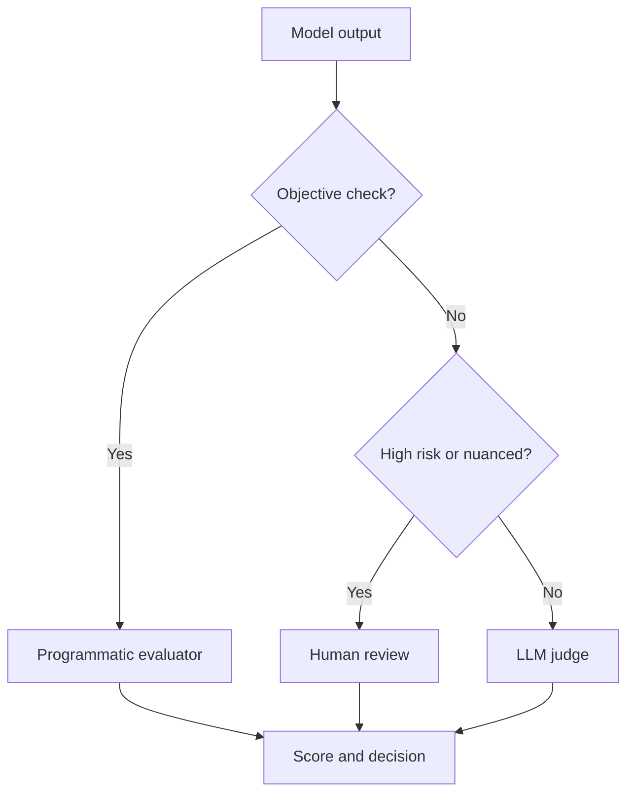
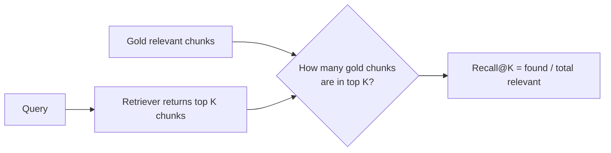
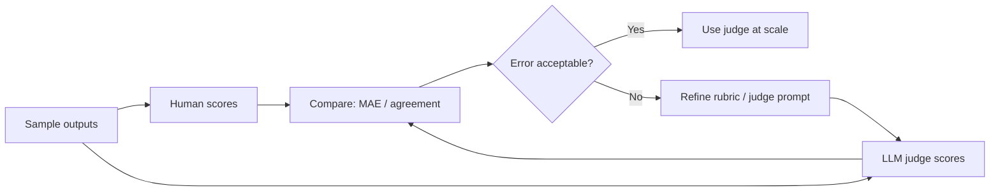
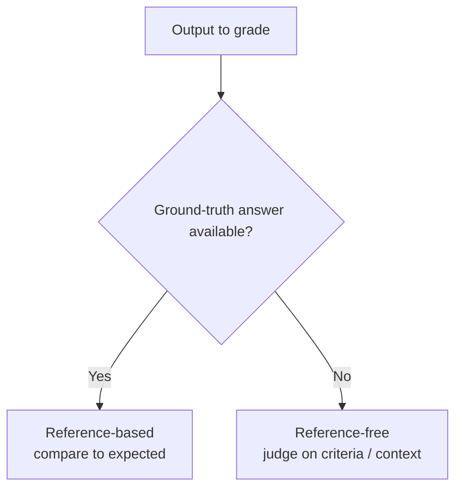

# LLM Evals — Part 4B: LLM Evaluation Methods

## Part B — LLM Evaluation Methods

### 47. What Is an Evaluation Method?
An eval method is the mechanism used to judge an output against a criterion, such as an exact expected answer, a human rubric, or a model-generated score.

### 48. Three Core Execution Styles
1. **Programmatic/deterministic:** rules, exact matches, calculations, or known labels.
2. **Human-based:** people judge quality using a rubric or comparative preference.
3. **Model-graded:** another LLM scores the output against explicit criteria.

These methods can be combined in one evaluation pipeline.

**Rule of thumb:** Use code for exact labels and schemas, humans for high-stakes nuance, and an LLM judge for scalable open-ended checks after calibration.

### 49. Example: Zomato Email Classifier
Task: classify incoming emails into labels such as **order issue**, **refund**, **delivery**, or **general query**. Create labeled examples, run the classifier, then compare predictions with expected labels using accuracy, precision, recall, and F1. Add human review for ambiguous or high-impact cases.

### 50. Method 1 — Programmatic / Deterministic Evaluation
Best when the answer or rules can be checked objectively. Examples: exact label match, JSON schema validity, required fields present, correct tool name, or numeric tolerance. It is fast and repeatable, but does not fully measure subjective qualities such as helpfulness.

### 51. Retriever Evaluation and Recall@K
**Recall@K** measures how many relevant documents appear in the top *K* retrieved results.

\[
\text{Recall@K} = \frac{\text{Relevant items in top K}}{\text{Total relevant items for the query}}
\]

**Example:** If a query has 4 relevant chunks and the top 5 results contain 3 of them, Recall@5 = 3/4 = **0.75 (75%)**.

### 52. Improving the Retriever
Test embedding models, chunk size/overlap, metadata filters, query rewriting, and different values of **K**. Measure retrieval quality and final answer quality together: increasing K may add useful evidence, but can also introduce noise, latency, and cost.

### 53. Method 2 — Human-Based Evaluation
People review outputs when quality depends on context, nuance, or user preference. Use clear instructions, representative cases, a consistent rubric, and examples of each score level.

### 54. A 1–5 Helpfulness Rubric
- **1:** Incorrect or not useful.
- **2:** Mostly misses the user’s need.
- **3:** Partly useful, with notable gaps.
- **4:** Helpful and mostly complete, with minor issues.
- **5:** Accurate, relevant, complete, and directly useful.

Define the scale before grading so different reviewers interpret scores consistently.

### 55. Multiple Graders and Disagreement
Use multiple graders for subjective or high-stakes cases. Compare score distributions and agreement, discuss ambiguous examples, and revise the rubric. Disagreement can signal unclear criteria—not merely a poor grader.

### 56. Common Human-Eval Styles
- **Rubric grading:** score each response against defined criteria.
- **Pairwise preference / A–B testing:** choose which of two outputs is better.
- **Expert review:** specialists judge domain-specific correctness.
- **Red teaming:** intentionally probe for unsafe or exploitable behavior.
- **User feedback / usability review:** collect real-world satisfaction and task-completion signals.

These are common approaches, not a universal fixed taxonomy.

### 57. Quality vs. Cost in Human Evals
Human review is valuable for nuance but can be slow and costly. Prioritize expert review for risky cases, sample routine cases, and use automated checks for straightforward criteria. Calibrate human reviewers before scaling.

### 58. Method 3 — Model-Graded Evaluation (LLM as Judge)
A judge LLM assesses a candidate answer against a rubric. It scales well for open-ended outputs, but can be biased by wording, answer length, position, or its own model limitations. Validate judge scores against human judgments.

### 59. Case Study: UPSC Mains Answer Evaluation
A judge can score a written answer on dimensions such as factual accuracy, relevance to the question, structure, analysis, examples, and conclusion. Specify the maximum marks and criteria for each dimension; the judge should not award marks for unsupported claims or content unrelated to the prompt.

### 60. Designing a Strong Judge Rubric
Include:
- The question and candidate answer.
- Explicit criteria and maximum marks per criterion.
- What earns full, partial, or zero marks.
- Constraints against rewarding irrelevant or fabricated content.
- A structured output schema, such as criterion scores, total score, and brief evidence-based explanation.

Treat judge “reasoning” as an explanation to inspect, not proof that its score is correct.

### 61. Human vs. LLM Scores
Score the same sample with humans and the LLM judge. Compare average scores, rank ordering, disagreement cases, and the judge’s consistency. Review mismatches before trusting the judge at scale.

### 62. Measuring Judge Error with MAE
Mean Absolute Error (MAE) measures the average absolute difference between judge scores and reference human scores.

\[
\text{MAE} = \frac{1}{n}\sum_{i=1}^{n}|J_i-H_i|
\]

**Example:** Human scores = [4, 5, 3], judge scores = [3, 4, 4]. Absolute errors = [1, 1, 1], so MAE = **1.0 point**. Lower MAE means closer scores, but does not alone guarantee fair or reliable judgments.

### 63. Reference-Based vs. Reference-Free Evals
- **Reference-based:** compares output with a known answer, label, or source. Useful for classification and tasks with trustworthy targets.
- **Reference-free:** evaluates using criteria without one single gold answer, often with a rubric or judge. Useful for open-ended responses, but needs careful calibration.

Some evaluations use both references and rubric-based checks.

### 64. Offline vs. Online Evaluation
- **Offline evals:** run a fixed dataset before release or after a change; controlled and reproducible.
- **Online evals:** monitor real production traffic using feedback, sampled reviews, error rates, safety signals, latency, and cost.
- **Loop:** production failures → curated test cases → offline regression suite → improvements → monitored deployment.

### 65. Production-Grade Mindset — Final Checklist
- Define measurable success criteria before tuning.
- Keep a versioned golden dataset and add real failure cases.
- Evaluate components, workflows, and the full application.
- Combine programmatic checks, human review, and model judges where appropriate.
- Track quality, safety, latency, and cost together.
- Re-run regression tests after each significant change and monitor after deployment.
