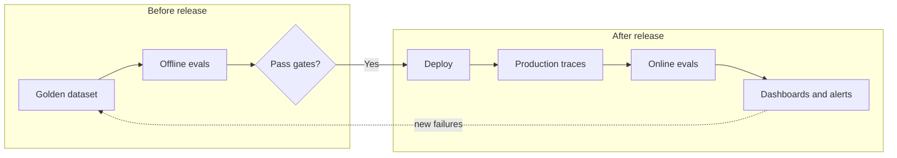
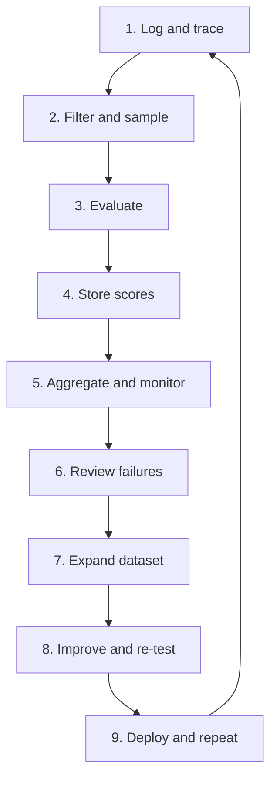

# LLM Evals — Part 5: Offline vs. Online Evaluation

## 1. Offline vs. Online Evals

- **Offline evals:** Test an AI application on a curated dataset **before release**. Main question: *Does it answer correctly on known test cases?*
- **Online evals:** Monitor real user traffic **after deployment**. Main question: *Is the application behaving normally and safely in production?*
- Use both: offline tests validate changes; online checks reveal real-world failures and drift.

| Offline Evals | Online Evals |
|---|---|
| Before deployment | After deployment, on production traces |
| Curated test/golden dataset | Real user interactions (often sampled) |
| Focus on correctness and comparison | Focus on live quality, safety, anomalies, and trends |
| Repeatable and controlled | Reflects changing users and real-world inputs |
| Supports release decisions and regression tests | Supports alerts, investigation, and continuous improvement |

> **Important:** Offline evals can test safety and cost too, while online evals can assess correctness. The distinction is mainly *when and on what data* they run—not an absolute split in what they measure.

## 2. Regression Testing

- A change to a prompt, model, retriever, or code can fix one issue and break another.
- **Regression testing** reruns a known dataset after a change to check that previously working behavior has not worsened.
- Compare results with a baseline and investigate both regressions and improvements before release.

## 3. Online Evaluation Pipeline — Step by Step

1. **Log and trace:** Capture inputs, outputs, component/tool runs, latency, token usage, errors, and relevant metadata.
2. **Filter and sample:** Select useful traces—for example, a percentage of normal traffic or all failed/low-rated requests.
3. **Evaluate:** Run deterministic checks, an LLM-as-a-judge rubric, safety checks, or a combination.
4. **Store feedback and scores:** Attach evaluator results to traces so examples can be inspected and compared over time.
5. **Aggregate and monitor:** Track quality scores, error rates, latency, token use, and cost; define thresholds or alerts.
6. **Review failures:** Inspect low-scoring or unusual traces, and ask humans to verify important or ambiguous cases.
7. **Expand the dataset:** Turn useful production failures and edge cases into test examples, removing private or sensitive data as required.
8. **Improve and re-test:** Update the prompt, model, retrieval, tools, or code; run offline evaluations and regression tests.
9. **Deploy and repeat:** Release only after checks pass, then continue monitoring production behavior.

## 4. Why Sample Production Traces?

- Evaluating every request with a costly LLM judge can add significant latency and expense.
- **Sampling** runs evaluators on a selected fraction of traces; filters can prioritize failures, specific routes, tools, or user feedback.
- Example: a 10% sampling rate sends about 1 in 10 eligible traces to an evaluator on average.
- Sampling is useful for scalable monitoring, but rare or high-risk cases may need dedicated checks rather than random sampling alone.

## 5. LangSmith — What It Helps With

**LangSmith** is a platform for tracing, evaluating, and monitoring LLM applications.

- **Tracing:** Inspect a request's path through prompts, model calls, retrievers, tools, and nested components.
- **Conversation/run history:** Store traces of model and application activity when tracing is configured. This helps debug failed or unexpected responses.
- **Datasets and experiments:** Keep curated examples and compare application versions against them with offline evaluations.
- **Online evaluators:** Score production traces using code-based checks or LLM-as-a-judge evaluators.
- **Filters and sampling:** Choose which traces trigger an evaluator to control cost and target relevant traffic.
- **Feedback and monitoring:** Review scores, compare trends, identify failure patterns, and feed useful cases into future tests.

**Typical workflow:** Instrument the app → view traces → configure filters/sampling → attach evaluators → inspect scores and failures → add examples to a dataset → run offline experiments → improve and redeploy.

**Data note:** Traces may contain user prompts, outputs, and retrieved content. Follow your organisation's privacy/security rules; avoid logging secrets and sensitive data, and configure masking or access controls where needed.

## 6. The Self-Improving Evaluation Loop

**Production traffic → traces → online evaluation → failure analysis → curated dataset expansion → offline/regression tests → system improvement → redeployment → production monitoring**

The system does not automatically improve just because it is evaluated. Engineers must review findings, make changes, verify them offline, and deploy them deliberately.

## Quick Recap

- **Offline:** *Is this version good enough to release?*
- **Online:** *Is the live system continuing to behave as expected?*
- **Regression tests:** *Did the latest change break something that used to work?*
- **LangSmith:** Helps trace application runs and manage offline experiments and online evaluations.
- **Self-improving loop:** Production failures become new tests, helping the next version become more reliable.

## References

- [LangSmith: Evaluation types](https://docs.langchain.com/langsmith/evaluation-types)
- [LangSmith: Online LLM-as-a-judge evaluations](https://docs.langchain.com/langsmith/online-evaluations-llm-as-judge)
