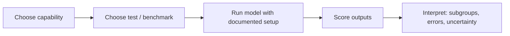
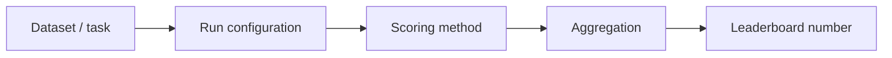
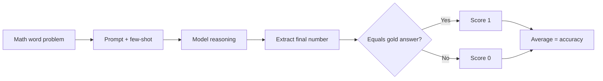

# LLM Evaluations: Model Evals & Benchmarks

> **Core idea:** Model evaluations measure what an LLM can do. A benchmark makes the test more standardized so models can be compared under a declared protocol.

## 1. Model Evals: The Basic Workflow

**Model evaluation** measures an LLM's capabilities, limitations, reliability, and sometimes its safety.



1. **Choose what to measure** — e.g., knowledge, math, instruction following, tool use, or coding.
2. **Choose a test** — a public benchmark, a private test set, or both.
3. **Run the model** under a documented evaluation setup.
4. **Score the outputs** using a defined metric.
5. **Interpret the results** — examine overall scores, subgroups, error patterns, and uncertainty.

A benchmark score is evidence about performance on a particular test—not proof that a model is generally intelligent or suitable for every application.

## 2. The 8 Core Capability Areas

This is a useful study taxonomy, not a universal official classification. Benchmarks often overlap multiple areas.

| Capability | What to test | Example benchmarks |
|---|---|---|
| 1. Knowledge & reasoning | Recall, comprehension, multi-step reasoning, expert-level QA | MMLU, MMLU-Pro, GPQA, AGIEval, SimpleQA, Humanity's Last Exam (HLE) |
| 2. Instruction following | Whether the model obeys format, length, keyword, and constraint instructions | IFEval, FollowBench |
| 3. Safety & alignment | Harmful-request handling, jailbreak resistance, refusal quality, truthfulness, bias | StrongREJECT, JailbreakBench, XSTest, TruthfulQA, BBQ |
| 4. Agentic & tool use | Correct tool selection, arguments, multi-step actions, task completion | BFCL, AgentBench, τ-bench, WebArena, GAIA |
| 5. Vision & multimodal | Reasoning across images, charts, documents, video, audio, or mixed inputs | MMMU, MMMU-Pro, MathVista, Video-MME |
| 6. Long context | Finding, connecting, and reasoning over information across long inputs | LongBench, RULER, Needle-in-a-Haystack tests |
| 7. Mathematics | Arithmetic word problems, formal reasoning, competition-level mathematics | GSM8K, MATH, AIME-style tests, FrontierMath |
| 8. Coding & software engineering | Code generation, executable correctness, debugging, repository-level issue resolution | HumanEval, MBPP, LiveCodeBench, SWE-bench |

**Important:** One benchmark rarely measures a whole capability. For example, passing multiple-choice questions does not automatically prove that a model can explain its reasoning reliably, use tools, or solve a real engineering task.

---

## 3. What Is an LLM Benchmark?

An **LLM benchmark** is a standardized test containing tasks, data, evaluation rules, and a scoring protocol. It helps compare models under similar conditions.

### The exam analogy

- **Benchmark = exam paper and marking rules.** It defines the questions, expected outputs, and how answers are scored.
- **Evaluation harness = exam administration system.** It loads the model and dataset, applies prompts and settings, runs inference, records outputs, scores results, and produces reports.
- **Leaderboard = published result table.** Useful for comparison, but only meaningful when the underlying evaluation setups are comparable.

### Four core benchmark components

1. **Dataset / task:** The questions, inputs, examples, labels, and test split.
2. **Run configuration:** Prompt template, few-shot examples, decoding settings, token limits, model version, context window, and permitted tools.
3. **Scoring method:** The rule for deciding whether an output is correct or how well it meets the criterion.
4. **Aggregation:** The method used to combine per-question scores into task, category, and overall results.



A practical benchmark run should also record the **harness version, code revision, model identifier, raw outputs, errors, latency, and cost** so others can reproduce or audit it.

## 4. Run Configuration: Why It Matters

Results can change when the configuration changes—even if the model stays the same.

- **Zero-shot:** The prompt contains the task but no worked examples.
- **Few-shot:** A prompt includes examples. **8-shot** means eight demonstrations are provided, if that is the benchmark's prescribed setup.
- **Chain-of-thought (CoT):** The prompt asks for step-by-step reasoning. It can help some tasks, but results should follow the benchmark's declared protocol; do not add CoT only to one model in a comparison.
- **Temperature:** Controls sampling randomness. Lower values are usually more reproducible; they do not guarantee identical results across every backend.
- **Token budget:** Maximum output length. A limit that is too small can cut off otherwise correct answers.
- **System/chat template:** Changes how instructions and conversation roles are presented to the model.
- **Tools and browsing:** Must be consistent with the benchmark's rules. A closed-book test should not silently become an internet-search test.
- **Model/version:** Record the exact checkpoint or API model version where possible.

**Benchmark rule:** Compare models using the same prompt, examples, decoding policy, token budget, tools, dataset split, and scoring procedure—or clearly disclose every difference.

## 5. Scoring: From Answers to Numbers

Choose a scorer that matches the task.

| Scoring method | How it works | Best suited for |
|---|---|---|
| Exact match | Output must match the reference, sometimes after normalization | Short answers, labels, structured outputs |
| Multiple-choice accuracy | Counts selected options that match the answer key | MMLU, GPQA and similar tests |
| Programmatic tests | Runs unit tests or validators against generated output | Coding and structured tasks |
| Model-graded / LLM judge | A judge model scores an answer against a rubric or reference | Open-ended answers where exact match is unsuitable |
| Human grading | Trained reviewers apply a rubric | Nuanced quality, expert judgement, safety review |

**Parsing matters:** If the model gives the correct answer but the parser extracts the wrong option or number, the score may be wrong. Inspect raw outputs and parser failures, not just the final score.

### Pass@1, Pass@k, and Majority@k

- **Pass@1:** At least one sampled solution is not allowed to rescue another; the first/only candidate must pass. This is the common single-attempt coding metric.
- **Pass@k:** The probability that **at least one of k generated candidates** passes the tests. It measures the benefit of generating multiple attempts, not necessarily the quality of the first attempt.
- **Majority@k (often written maj@k):** Generate *k* candidate answers, choose the most common answer by voting, and score that selected answer. This measures self-consistency / majority-vote performance.

For code benchmarks, a standard estimator of pass@k from *n* sampled candidates, of which *c* pass, is:

\[
\mathrm{pass@k}=1-\frac{\binom{n-c}{k}}{\binom{n}{k}}
\]

This formula applies when *n* candidates are sampled and *n-c* are failures. In papers and leaderboards, **always check the benchmark's exact definition**: `pass@k` and `maj@k` are not interchangeable, and majority-vote protocols can differ.

## 6. Aggregation: How Scores Are Combined

- **Per-task score:** Score on one dataset or task.
- **Macro average:** Calculate each task's score, then average tasks equally. A small task can count as much as a large task.
- **Micro / example-weighted average:** Pool the underlying examples, so larger datasets contribute more.
- **Category average:** Average selected tasks inside a capability category.
- **Overall score:** A benchmark-defined combination of task or category scores. The exact formula should be published.

A single overall number can hide weaknesses. Always examine **per-task results, error types, score variance, latency, cost, and safety results** alongside the aggregate.

**Small-sample warning:** A score of 90% on 20 questions means 18 answers were correct; it does not establish that the model's true performance is exactly 90%. Small samples have substantial statistical uncertainty.

---

## 7. Detailed Benchmark Study: Knowledge & Reasoning

The seven benchmarks below form a useful progression from broad subject knowledge to truthfulness, expert reasoning, open-ended factuality, and very difficult frontier problems.

### 7.1 MMLU — Massive Multitask Language Understanding

- **Measures:** Broad knowledge and problem-solving across **57 subjects**, including mathematics, history, law, medicine, and computer science.
- **Format:** Mostly multiple-choice questions.
- **Common score:** Accuracy.
- **Strength:** Broad, recognizable baseline for comparing subject knowledge.
- **Limitations:** Multiple-choice options provide clues; static questions may leak into training data; labels or questions can contain noise; some frontier models have made the original version less discriminative.
- **Use it for:** A broad baseline or regression check, especially when comparing with older model results. Consider MMLU-Pro or harder expert tests for additional discrimination.
- **Reference:** [Original MMLU paper](https://arxiv.org/abs/2009.03300) · [BenchWiki MMLU overview](https://benchwiki.vercel.app/benchmarks/mmlu)

### 7.2 TruthfulQA — Truthfulness vs. Common Misconceptions

- **Measures:** Whether the model repeats common false beliefs or provides a truthful answer.
- **Dataset:** The original benchmark has **817 questions across 38 categories**, including health, law, finance, and politics.
- **Scoring:** Depends on the selected version and protocol; generation-based truthfulness/informativeness scoring differs from the newer multiple-choice format.
- **Strength:** Targets a failure that ordinary knowledge tests may miss: a plausible answer can still be false.
- **Limitations:** It measures a specific set of misconception-prone questions, not all factuality or hallucinations. Version and scoring choice matter.
- **Use it for:** Truthfulness and alignment analysis, not as a universal hallucination score.
- **Reference:** [Original paper](https://arxiv.org/abs/2109.07958) · [TruthfulQA repository and version note](https://github.com/sylinrl/TruthfulQA)

### 7.3 AGIEval — Human-Centric Exams

- **Measures:** Performance on human-designed standardized exams, such as college entrance, law-school admission, and other professional or academic assessments.
- **Strength:** Uses tasks people recognize as cognitively demanding and offers human-performance context for some exams.
- **Limitations:** An exam score depends on language, exam format, memorization, allowed tools, and test-specific preparation. It does not demonstrate broad real-world autonomy.
- **Use it for:** Exam-style reasoning and human-centric task comparison.
- **Reference:** [AGIEval paper](https://arxiv.org/abs/2304.06364)

### 7.4 GPQA — Graduate-Level Google-Proof Q&A

- **Measures:** Difficult graduate-level science reasoning in biology, physics, and chemistry.
- **Dataset:** The original benchmark contains **448 expert-written multiple-choice questions**. **GPQA Diamond** is a harder subset commonly used in frontier-model comparisons; results should identify the exact split.
- **Strength:** Expert-authored, difficult questions that are not easily solved by casual web search.
- **Limitations:** Narrow scientific coverage; small subsets make each question influential; results still depend on prompting and evaluation protocol.
- **Use it for:** Stress-testing expert scientific reasoning, alongside broader benchmarks.
- **Reference:** [GPQA paper](https://arxiv.org/abs/2311.12022) · [MLCommons GPQA summary](https://mlcommons-science.github.io/benchmark/md/benchmarks/gpqa_a_graduate-level_google-proof_question_and_answer_benchmark/)

### 7.5 MMLU-Pro — A Harder MMLU Successor

- **Measures:** Broader and more reasoning-intensive academic knowledge.
- **Design changes:** Uses **10 answer options rather than four**, filters noisy/trivial questions, and increases reasoning difficulty across 14 domains.
- **Strength:** Reduces easy guessing and provides a more challenging comparison than the original MMLU.
- **Limitations:** Still largely exam-style and multiple-choice; few-shot examples, CoT instructions, and answer extraction can change scores. Not every leaderboard uses the same configuration.
- **Use it for:** A stronger general academic benchmark where MMLU scores are too clustered.
- **Reference:** [MMLU-Pro paper / project](https://arxiv.org/abs/2406.01574) · [BenchWiki MMLU-Pro overview](https://benchwiki.vercel.app/benchmarks/mmlu-pro)

### 7.6 SimpleQA — Short-Answer Factuality

- **Measures:** Whether a model answers short, fact-seeking questions correctly rather than confidently inventing an answer.
- **Dataset:** **4,326** concise questions, designed to have a single verifiable answer.
- **Scoring:** A grader categorizes responses as correct, incorrect, or not attempted; the protocol can also support calibration analysis.
- **Strength:** Free-response answers provide fewer clues than multiple-choice tests, making factual recall more visible.
- **Limitations:** It focuses on short-form factual questions. Results with browsing enabled are not comparable with closed-book results. An LLM grader can introduce its own errors.
- **Use it for:** Closed-book factuality and abstention/calibration analysis.
- **Reference:** [OpenAI: Introducing SimpleQA](https://openai.com/index/introducing-simpleqa/) · [BenchWiki SimpleQA overview](https://benchwiki.vercel.app/benchmarks/simpleqa)

### 7.7 Humanity's Last Exam (HLE)

- **Measures:** Very difficult expert-level questions across many academic and specialized domains, including multimodal questions.
- **Strength:** Designed to expose gaps that easier, saturated knowledge tests may no longer reveal.
- **Limitations:** Extremely difficult questions can yield low scores and high variance; breadth does not equal complete capability coverage. Check whether tools, browsing, and multimodal inputs are allowed in the particular report.
- **Use it for:** Frontier stress testing, alongside easier baselines and application-specific tests—not as the only measure of usefulness.
- **Reference:** [Humanity's Last Exam project/paper](https://arxiv.org/abs/2501.14249) · [BenchWiki benchmark database](https://benchwiki.vercel.app/)

### Knowledge benchmark comparison at a glance

| Benchmark | Main question it asks | Typical response style | Main caveat |
|---|---|---|---|
| MMLU | Does the model know a broad range of academic subjects? | Multiple choice | May be saturated; options help recognition |
| TruthfulQA | Does it resist common misconceptions? | Generated or multiple-choice, depending on version | Specific truthfulness stress test, not all hallucinations |
| AGIEval | How does it perform on human exam tasks? | Exam questions | Exam scores do not equal general intelligence |
| GPQA / Diamond | Can it solve expert science questions? | Multiple choice | Narrow domain; small subsets are sensitive to setup |
| MMLU-Pro | Can it handle harder, reasoning-heavy academic questions? | 10-option multiple choice | Prompt/configuration and parser must match the protocol |
| SimpleQA | Can it recall short facts without making them up? | Short free response | Closed-book vs. browsing changes the task |
| HLE | Can it solve very difficult expert-level problems? | Text and multimodal tasks | Very hard, so scores require careful context |

---

## 8. Benchmark Examples Across the Other Seven Capability Areas

### A. Instruction Following

**IFEval** uses verifiable instructions such as minimum word counts, required phrases, and formatting constraints. It is helpful because many instructions can be checked programmatically rather than graded only by subjective preference.

- Example failure: “Return exactly three bullet points” produces four bullets.
- Metrics: instruction-level compliance, prompt-level strict accuracy, and constraint-specific error rates.
- Caveat: A model can pass formal constraints while giving low-quality or incorrect content.
- Reference: [IFEval paper](https://arxiv.org/abs/2311.07911)

### B. Safety & Alignment

Safety benchmarks test different risks and should not be collapsed into one generic “safe” score.

- **Truthfulness / misinformation:** TruthfulQA and task-specific factuality tests.
- **Jailbreak robustness:** JailbreakBench or StrongREJECT-style harmful-request tests.
- **Over-refusal and under-refusal:** Tests that distinguish harmful requests from benign requests that merely resemble them.
- **Bias / representational harms:** Benchmarks such as BBQ.
- **Toxicity:** Toxic-language or toxicity-classification tests.

Report both **unsafe compliance** and **unnecessary refusal**. A system that refuses every request may score well on one safety measure but is not useful.

### C. Agentic & Tool Use

- **BFCL (Berkeley Function Calling Leaderboard):** Tests accurate function selection and argument generation; later versions include multi-turn and broader agentic behavior.
- **AgentBench:** Evaluates agents in multiple interactive environments.
- **WebArena:** Tests realistic browser-based website tasks.
- **τ-bench:** Evaluates agents following domain rules and interacting with tools in simulated service workflows.
- **GAIA:** Tests general assistant tasks that may require reasoning, tool use, and multiple steps.

Useful metrics include task success rate, correct tool selection, valid arguments, unnecessary tool calls, tool error rate, trajectory quality, completion time, and cost per completed task. A syntactically correct tool call is not necessarily a successful task.

References: [BFCL leaderboard](https://gorilla.cs.berkeley.edu/leaderboard) · [AgentBench paper](https://arxiv.org/abs/2308.03688) · [WebArena paper](https://arxiv.org/abs/2307.13854)

### D. Vision & Multimodal

- **MMMU:** College-level multidisciplinary questions involving images such as charts, diagrams, tables, and scientific figures.
- **MMMU-Pro:** A harder, more robust version that aims to reduce shortcuts from text-only cues and test genuine visual understanding.
- **MathVista:** Mathematical reasoning that requires visual information.
- **Video-MME:** Video understanding across different durations and visual/audio content, depending on the protocol.

Evaluate perception, OCR/chart reading, cross-modal reasoning, grounding, and final answer accuracy separately where possible. Text-only performance is not a proxy for multimodal ability.

References: [MMMU paper](https://arxiv.org/abs/2311.16502) · [MMMU-Pro paper](https://arxiv.org/abs/2409.02813)

### E. Long Context

- **LongBench:** Multi-task and bilingual long-context evaluation covering tasks such as document QA, multi-document QA, summarization, and code completion.
- **RULER:** Tests long-context abilities at different context lengths and task types.
- **Needle-in-a-Haystack:** Places a fact inside long text and measures whether the model can retrieve it. Useful as a diagnostic, but too narrow to represent all long-context reasoning.

Test not only whether the advertised context window accepts a long prompt, but whether the model can **find, connect, prioritize, and reason over** relevant information near the beginning, middle, and end.

Reference: [LongBench paper](https://arxiv.org/abs/2308.14508)

### F. Mathematics

- **GSM8K:** Grade-school math word problems that require several reasoning steps. The Hugging Face dataset release lists 17,584 rows across its splits; commonly used evaluation focuses on the test split.
- **MATH:** Competition-style problems across multiple mathematical areas.
- **AIME-style tests:** Difficult contest problems that typically require an exact numerical answer.
- **FrontierMath:** Very challenging mathematics problems designed to probe capabilities beyond standard school-level benchmarks.

Use exact final-answer parsing where appropriate, and inspect whether the model reached the answer through a valid method if process quality matters. A correct final number does not always prove robust reasoning.

References: [GSM8K paper](https://arxiv.org/abs/2110.14168) · [GSM8K dataset card](https://huggingface.co/datasets/openai/gsm8k)

### G. Coding & Software Engineering

- **HumanEval / MBPP:** Short programming tasks judged by running generated code against tests.
- **LiveCodeBench:** Uses newer programming questions and repeated updates to reduce contamination and track performance over time.
- **SWE-bench:** Presents real GitHub issues and asks a model/agent to modify a repository to resolve them. The original dataset contains 2,294 issues from 12 Python repositories.

Distinguish short code generation from repository-level engineering. Report unit-test pass rate, pass@1/pass@k, runtime failures, patch correctness, regression tests, and—in agentic coding—tool actions and total cost.

References: [SWE-bench paper](https://arxiv.org/abs/2310.06770) · [EleutherAI LM Evaluation Harness](https://github.com/EleutherAI/lm-evaluation-harness)

---

## 9. GSM8K Walkthrough: Dataset to Score

**GSM8K** is a useful example of how a benchmark becomes an executable evaluation.



1. **Dataset:** Load the official dataset and select the declared split (commonly `test`).
2. **Input:** Send the math word problem to the model.
3. **Prompt:** Follow the benchmark's specified template—zero-shot or few-shot, with or without CoT. Do not change it silently between models.
4. **Generation:** Fix the model version, temperature, maximum output tokens, and any sampling policy.
5. **Extraction:** Parse the final numeric answer from the response.
6. **Scoring:** Compare the extracted result to the reference answer using the benchmark's normalization rules.
7. **Aggregation:** Compute the fraction correct across the examples.
8. **Audit:** Save prompts, generations, parsed answers, failures, and configuration for debugging.

\[
\text{Accuracy} = \frac{\text{number of correct answers}}{\text{number of scored questions}} \times 100\%
\]

**Example:** If a model answers 90 out of 100 questions correctly, accuracy is 90%. Always report the sample count; 90% on 100 questions is not the same amount of evidence as 90% on 10,000 questions.

**Why run several samples?** With stochastic generation, repeat runs may vary. For a pass@k test, generate *k* candidates and see whether at least one passes. For majority@k, vote among candidate answers and score the voted answer. Clearly state which procedure is used.

---

## 10. Evaluation Harnesses and Tools

### EleutherAI `lm-evaluation-harness`

An open-source framework for running standardized language-model evaluations. It supports many predefined tasks, few-shot settings, configurable model backends, and saved sample outputs.

Example command for a Hugging Face model (adjust model and task names to the environment):

```bash
pip install "lm_eval[hf]"

lm_eval \
  --model hf \
  --model_args pretrained=<MODEL_ID> \
  --tasks gsm8k \
  --num_fewshot 0 \
  --batch_size 8 \
  --device cuda:0 \
  --log_samples \
  --output_path ./eval-results
```

- Change `<MODEL_ID>` to the model checkpoint.
- Use the task's required configuration rather than choosing zero-shot arbitrarily.
- `--log_samples` helps inspect individual outputs and scoring problems.
- Record the package version, model revision, task revision, command, and hardware.

Documentation: [GitHub repository and usage guide](https://github.com/EleutherAI/lm-evaluation-harness)

### DeepEval

DeepEval is an open-source framework aimed at **LLM application evaluations** as well as model benchmarks. It supports test cases, metrics, component-level and end-to-end evaluation, and LLM-as-a-judge workflows. This makes it useful when evaluating an application such as a RAG chatbot, agent, classifier, or summarizer—not just raw model knowledge.

- Use benchmark modules to run supported standardized tests.
- Use custom test cases and metrics to evaluate your own application behavior.
- Keep the metric, threshold, judge model, and evaluation dataset documented.

Documentation: [Benchmark introduction](https://deepeval.com/docs/benchmarks-introduction) · [Evaluation introduction](https://deepeval.com/docs/evaluation-introduction)

### BenchWiki

[BenchWiki](https://benchwiki.vercel.app/) is a useful index for researching benchmark definitions, history, status, and reported results. Use it to discover candidates and understand context; verify critical claims against original papers, official repositories, and the exact leaderboard methodology.

When looking at a benchmark page, check:

1. Is the result **vendor-reported or independently reproduced**?
2. Which model version and evaluation date are shown?
3. Which dataset split, prompt, shot count, tool policy, and scoring method were used?
4. Is the benchmark active, saturated, or known to have data/label issues?
5. Are the raw responses and evaluation code available?

---

## 11. Common Benchmark Problems

### 1. Data contamination and memorization

The test questions or answers may have appeared in pre-training data. A model can recall examples rather than generalize.

**Mitigation:** Use private or newly created holdout tests, monitor contamination reports, use dynamic/live benchmarks where suitable, and rotate test items without exposing the test set.

### 2. Benchmark saturation

When top models cluster near the maximum score, a benchmark stops distinguishing their capabilities well.

**Mitigation:** Keep older benchmarks for continuity, but add harder or newer tests (e.g., MMLU-Pro, GPQA, HLE) and application-specific evaluations.

### 3. Configuration gaming

Scores can be improved by selecting favorable prompts, many samples, answer hints, or tools that other models did not receive.

**Mitigation:** Publish the full protocol and compare like with like. Separate official benchmark results from exploratory best-case results.

### 4. Misleading aggregation

A high average can conceal poor performance on important domains, minority languages, safety tests, or long-context tasks.

**Mitigation:** Publish per-task and per-category scores, not only a single leaderboard number.

### 5. Weak or noisy scoring

Regex parsers can misread answers; reference labels can be wrong; LLM judges can be inconsistent or favor certain styles/models.

**Mitigation:** Audit samples manually, validate parsers, use clear rubrics, measure judge-human agreement, and disclose scorer versions.

### 6. Static tests vs. real conditions

A static question set may not represent changing facts, long conversations, real tools, latency limits, or multi-step workflows.

**Mitigation:** Combine public benchmarks with private task-specific tests, adversarial tests, realistic simulations, and production monitoring.

### 7. Scores without uncertainty or cost

A small test can produce unstable rankings. A model may gain accuracy while becoming much slower or more expensive.

**Mitigation:** Report sample sizes, confidence intervals or repeated runs when suitable, latency, token use, cost, and task-success-per-dollar.

### 8. Safety score collapse

One safety number may hide both dangerous compliance and excessive refusal of harmless requests.

**Mitigation:** Measure harmful compliance, refusal precision/recall, jailbreak robustness, and benign-request helpfulness separately.

---

## 12. Build a Trustworthy Benchmark Study

Use this checklist before believing or publishing a score:

- [ ] Define the exact capability and the question the test is intended to answer.
- [ ] Identify the benchmark version, dataset license, split, size, and reference labels.
- [ ] Inspect whether the test is contaminated, stale, saturated, or domain-biased.
- [ ] Lock prompt template, few-shot examples, CoT policy, temperature, token budget, tools, and model version.
- [ ] Run the official harness or publish the custom evaluation code.
- [ ] Validate answer parsing and the scorer on known examples.
- [ ] Save raw prompts, outputs, scores, failures, timestamps, and environment details.
- [ ] Report per-task metrics and the aggregation formula.
- [ ] Include sample counts and uncertainty; repeat stochastic tests when needed.
- [ ] Compare accuracy with safety, latency, cost, and robustness.
- [ ] Validate the public benchmark result with a **private evaluation set** tailored to the intended use.

## 13. From Model Benchmarks to Real Applications

A model benchmark answers: **“How well does this model perform on this standardized set of tasks?”**

An application evaluation answers: **“Does my complete system succeed for my users under realistic conditions?”**

For example, a RAG application may use a capable model but still fail because retrieval misses the right document, the prompt does not preserve evidence, or the answer is not grounded in the retrieved context. Therefore, evaluate both:

- **Model level:** general reasoning, knowledge, math, coding, instruction following, safety.
- **Application level:** retrieval quality, factuality relative to supplied context, task completion, tool correctness, robustness, latency, and cost.

**Best practice:** Use public benchmarks for standardized comparison, private eval datasets for product relevance, and online monitoring for behavior after deployment.

---

## 14. Quick Revision

- **Model eval:** Measure a model's capability on a defined task.
- **Benchmark:** Standardized dataset plus instructions, scoring, and reporting rules.
- **Evaluation harness:** Software that executes the benchmark consistently.
- **Pass@1:** Does a single candidate pass?
- **Pass@k:** Does at least one of *k* candidates pass?
- **Majority@k:** Does the most-voted candidate answer pass?
- **MMLU:** Broad academic knowledge.
- **MMLU-Pro:** Harder, reasoning-oriented multiple-choice knowledge evaluation.
- **TruthfulQA:** Resistance to common misconceptions.
- **AGIEval:** Human exam-style tasks.
- **GPQA:** Graduate-level science questions.
- **SimpleQA:** Short-form factuality.
- **HLE:** Very difficult expert-level questions.
- **GSM8K:** Grade-school mathematical word problems.
- **SWE-bench:** Real software-engineering issue resolution.
- **Golden rule:** Never trust one benchmark score alone; inspect the protocol, task-level results, errors, uncertainty, safety, latency, and cost.

## Further Reading

- [BenchWiki — LLM benchmark index](https://benchwiki.vercel.app/)
- [EleutherAI LM Evaluation Harness](https://github.com/EleutherAI/lm-evaluation-harness)
- [DeepEval benchmark documentation](https://deepeval.com/docs/benchmarks-introduction)
- [A Survey on Large Language Model Benchmarks (2025)](https://arxiv.org/abs/2508.15361)
- [Holistic Evaluation of Language Models (HELM)](https://arxiv.org/abs/2211.09110)
- [GSM8K dataset on Hugging Face](https://huggingface.co/datasets/openai/gsm8k)
