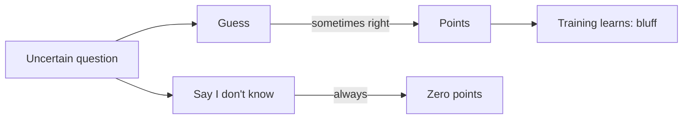
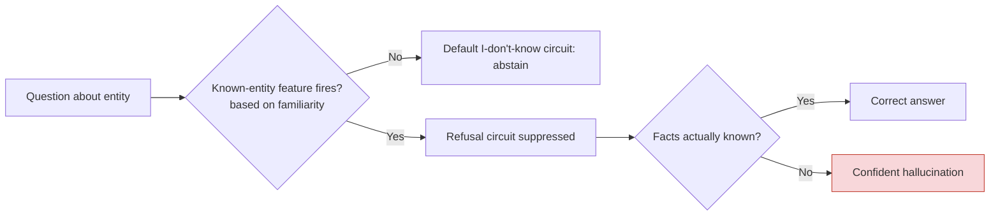

# Why LLMs Hallucinate: The Problem of Not Knowing What You Don't Know

At its core, an LLM is a **next-token predictor**. It has no internal concept of "truth" or "I don't know" — it simply generates the most statistically plausible continuation of a sequence. When it lacks the information to answer correctly, it doesn't experience a gap; it simply *fills the gap with a guess that sounds right*.

### The Training Incentive

OpenAI's 2025 paper [*Why Language Models Hallucinate*](https://openai.com/index/why-language-models-hallucinate/) makes the case precisely: **standard training and evaluation procedures reward guessing over acknowledging uncertainty**. Benchmarks like MMLU and GSM8K score a correct guess higher than "I don't know." The model learns to be a good test-taker — and on a test, guessing when uncertain *improves* your score. So the model is optimized to bluff.

### The Internal Circuit That Gets Suppressed

Anthropic's interpretability research on Claude found something striking: the model *does* have an internal "refusal / I don't know" circuit. It fires by default. But a separate "known entity" feature, when activated, **suppresses** that circuit. The problem is that this feature fires on *familiarity*, not *knowledge*. The model recognizes a name as "seemingly real," the refusal circuit is silenced, and the model is committed to producing an answer it doesn't actually have.

A 2026 follow-up paper (*Do LLMs Really Know What They Don't Know?*) went further: **internal states mainly reflect knowledge recall, not truthfulness**. When a hallucination comes from the same recall pathway as a correct answer, the model's internal signals look nearly identical. The model genuinely cannot tell the difference.

### Overconfidence Is the Norm, Not the Exception

A December 2025 benchmark called *KalshiBench* tested five frontier models (Claude Opus 4.5, GPT-5.2, DeepSeek-V3.2, Qwen3-235B, Kimi-K2) on genuinely unknowable future events. **Every model was systematically overconfident**, with expected calibration error (ECE) ranging from 0.120 to 0.395. Even the best-calibrated model had a 12-percentage-point gap between stated confidence and actual accuracy. Reasoning-enhanced models were *worse* at calibration despite higher accuracy.

### What's Being Done

- **ICLR 2026 – "Rewarding Doubt":** A reinforcement-learning approach that directly optimizes for calibrated confidence, letting models develop intrinsic uncertainty awareness without external supervision.
- **MIT 2026:** Measuring *epistemic uncertainty* by comparing a model's output against an ensemble of similar models — a simple but effective way to flag "confidently wrong" outputs that standard confidence scores miss.
- **Feature-Gaps (ICLR 2026):** Quantifies epistemic uncertainty by measuring hidden-state distance to an ideal model through a small set of interpretable features.

### The Bottom Line

A model that *knew* it didn't know would, in principle, stop hallucinating. But the architecture, the training incentives, and the evaluation landscape all conspire to make that self-awareness unreliable. The model doesn't have a "truth module" — it has a **pattern-completion engine** that was never designed to stop. The research frontier is moving toward giving models a genuine signal for "this is beyond my knowledge," but as of 2026, no production model reliably has one.
