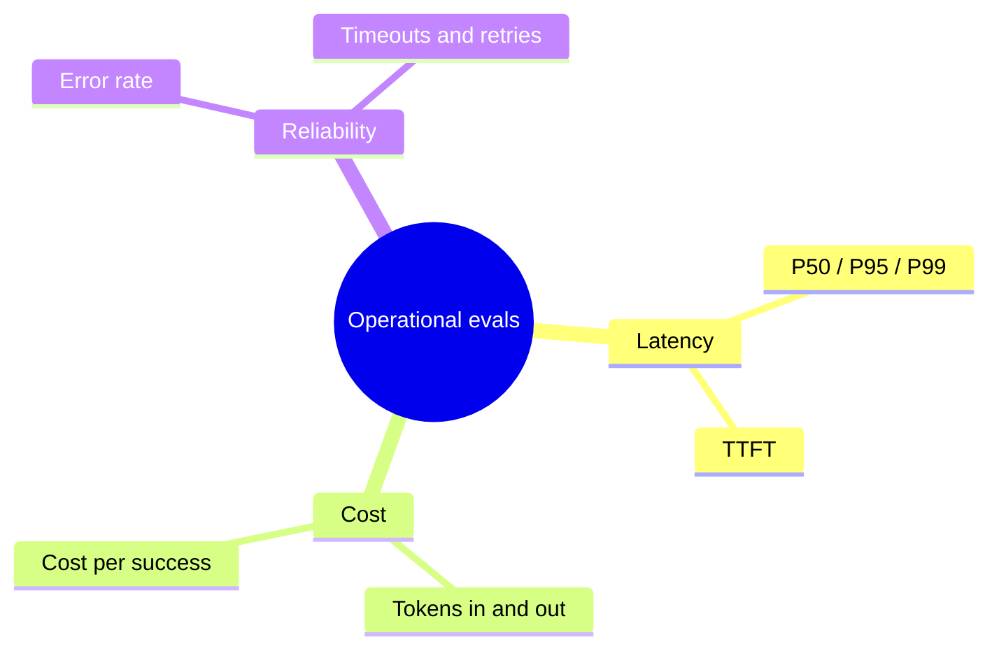
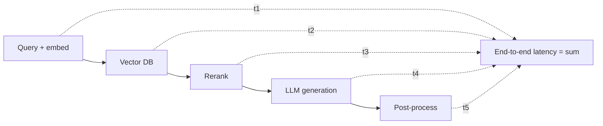

# LLM Evals — Operational Evaluations

> Short, practical notes based on the supplied video agenda.

## 1. What Are Operational Evaluations?

Operational evaluations measure how efficiently and reliably an AI application runs.



| Quality Evaluations | Operational Evaluations |
|---|---|
| Is the answer correct and useful? | Is it fast, affordable, and reliable? |
| Faithfulness, correctness, relevance | Latency, cost, throughput, error rate |

Both matter: a high-quality answer is not production-ready if it is too slow, expensive, or unreliable.

## 2. Why Run Operational Evals Offline?

Use controlled tests before deployment to compare models, prompts, retrieval settings, and infrastructure.

- Run the same workload for each candidate.
- Record model/version, configuration, region, concurrency, and hardware.
- Repeat runs to reduce temporary API/network noise.
- Use differential benchmarking: compare a baseline with a candidate.
- Include normal and peak-load scenarios.

Offline results are estimates; production monitoring is still necessary.

## 3. Latency

**Latency** is the time taken to produce a response. Averages can hide slow requests, so report percentiles.

| Metric | Meaning |
|---|---|
| **P50** | Median; 50% of requests finish at or below this time |
| **P95** | 95% of requests finish at or below this time |
| **P99** | 99% of requests finish at or below this time |

Example: P95 = 4 seconds means 95% of requests completed within 4 seconds and 5% took longer.

### Component-level latency

For a RAG app, measure:
- Query processing and embedding.
- Retriever/vector database.
- Reranking.
- LLM generation.
- Post-processing and network overhead.
- End-to-end response time.



### Time to First Token (TTFT)

- Time from sending a request until the first generated token arrives.
- Important for streaming because users see output before generation finishes.
- Also measure total response time and generation speed.

### Cold starts and warm-up

- **Cold start:** first request may be slower while a model, container, connection, or cache initializes.
- **Warm-up:** send preliminary requests before measuring steady-state performance.
- Report cold-start and warm performance separately.

Longer outputs generally take longer. Compare requests with similar output lengths.

### Latency vs. throughput

- **Latency:** time for one request to complete.
- **Throughput:** requests or tokens processed per unit time.
- Higher concurrency can improve throughput while increasing latency and errors.

### Latency budgets and SLOs

An **SLO (Service Level Objective)** is a measurable performance/reliability target.

Example (illustrative): P95 end-to-end latency below 5 seconds and 99% successful requests over a defined period. Set component budgets so the total stays within the end-to-end target.

## 4. Cost and Token Economics

LLM cost depends on token usage, model pricing, caching, and the number of calls.

```text
Query cost =
(input tokens / 1,000,000 × input price per 1M tokens)
+
(output tokens / 1,000,000 × output price per 1M tokens)
```

For RAG, include embedding, reranking, generator, judge, and retry costs.

Track:
- Average and P95 cost per request.
- Input vs. output tokens.
- Cost per successful/correct answer.
- Cost per user/session or task.
- Projected daily/monthly spend.
- Maximum budget per request.

### Cost optimization

- Route simple requests to smaller models.
- Use stronger models only when needed.
- Reduce unnecessary context and duplicate instructions.
- Tune chunk count and compress context.
- Cache repeated prompts/results when safe.
- Limit output tokens and unnecessary agent/tool loops.
- Re-check quality after optimization.

Use the provider's current pricing and account for cached-token pricing where applicable.

## 5. Reliability and Error Rates

Reliability evaluation checks whether requests complete consistently.

### Common failures

- **API errors:** provider/server returns an error.
- **Rate limits:** request or token limits are exceeded (often HTTP 429).
- **Timeouts:** response does not arrive within the configured limit.
- **Network failures:** connection drops or transport errors.
- **Invalid output:** malformed JSON, empty response, or unexpected format.
- **Dependency failures:** vector database, embedding service, or tool is unavailable.

### Metrics

```text
Success rate = successful requests / total requests × 100
Error rate   = failed requests / total requests × 100
```

Also track timeout rate, errors by category/status, retry count, retry success rate, availability, and failures after all retries.

### Retry strategy

- Retry transient failures only where appropriate.
- Use bounded retries with exponential backoff and jitter.
- Respect provider `Retry-After` instructions.
- Set request timeouts and an overall deadline.
- Avoid retrying non-retryable errors indefinitely.
- Use idempotency protection for side-effecting operations.

Retries can improve success rates but increase latency and cost. Measure all three.

## 6. Evaluation Scripts

Suggested structure:

```text
evals/
├── eval_latency.py
├── eval_cost.py
└── eval_reliability.py
```

Each script should:
1. Load a fixed workload.
2. Apply a documented model/application configuration.
3. Run a defined number of requests at planned concurrency.
4. Capture timestamps, token usage, cost, status, retries, and errors.
5. Calculate percentiles and summary statistics.
6. Save raw results and a summary report.
7. Compare results against baseline and SLO thresholds.

Record date, model ID/version, region, SDK version, prompt version, concurrency, and dataset version.

## 7. Practical Checklist

- [ ] Use the same workload across candidate configurations.
- [ ] Measure P50, P95, P99, and TTFT.
- [ ] Break down latency by RAG component.
- [ ] Test cold starts and warm runs separately.
- [ ] Measure throughput at realistic concurrency.
- [ ] Calculate input, output, and total cost per request.
- [ ] Include embeddings, reranking, retries, and judge calls in cost.
- [ ] Measure success rate, error rate, timeouts, and rate limits.
- [ ] Verify retry limits and backoff behavior.
- [ ] Define SLOs and release thresholds.
- [ ] Re-check answer quality after optimization.

## 8. Key Takeaway

**Quality evals ask:** “Is the answer good?”

**Operational evals ask:** “Can the system deliver that answer quickly, affordably, and reliably at scale?”

A production-ready LLM application needs both.

## Further Reading

- [Supplied operational evaluation video](https://www.youtube.com/watch?v=kuTgQM9zhq0)
- [OpenAI API pricing](https://openai.com/api/pricing/)
- [OpenAI API rate limits](https://platform.openai.com/docs/guides/rate-limits)
