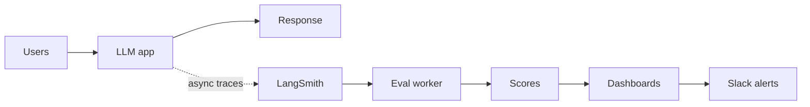
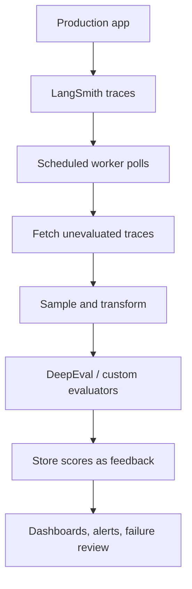
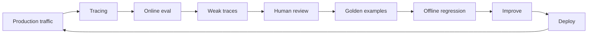

# LLM Evals: Online Evaluations & Continuous Production Monitoring

## 1. What Are Online Evals?

**Online evaluations** continuously assess an LLM application using real or sampled production interactions after deployment.



They help detect:
- Hallucinations and quality degradation
- Retrieval failures and irrelevant context
- Toxic or unsafe responses
- Latency spikes, API errors, and rising costs
- Regressions caused by prompt, model, data, or code changes

| Offline evals | Online evals |
|---|---|
| Run before release on a fixed dataset | Run after deployment on production traces |
| Controlled and repeatable | Reflect real user traffic |
| Useful for regression tests and release gates | Useful for monitoring and incident detection |
| Often use labelled reference answers | Live requests often lack reference answers |

Online monitoring complements offline testing; it does not replace it.

## 2. The Reference Constraint

Some metrics require a known correct answer or labelled evidence. Production requests usually do not have these references.

| Metric | Online? | Requirement |
|---|---|---|
| Latency, TTFT, token usage | Yes | Directly measured from traces |
| Cost per request | Yes | Token usage and model pricing |
| API/error rate | Yes | Execution outcomes |
| Toxicity / safety | Yes | Classifier or evaluator |
| Faithfulness | Usually | Retrieved context |
| Contextual relevancy | Usually | Query and retrieved context |
| Answer relevancy | Usually | Query and generated answer |
| Exact correctness / accuracy | Usually needs reference | Gold answer, labels, or external verification |
| Recall@K / Precision@K | Needs labels | Relevant reference documents/chunks |

**Important:** Reference-free does not mean objectively correct. LLM judges estimate quality and can be biased or inconsistent. Validate them with labelled samples and human review.

## 3. Selecting an Online Evaluation Suite

Choose metrics based on the application's risks. A practical RAG monitoring suite includes:

### RAG Triad
1. **Contextual relevancy:** Is the retrieved context relevant to the question?
2. **Faithfulness:** Is the answer supported by the retrieved context?
3. **Answer relevancy:** Does the answer address the user's question?

### Safety and operations
- **Toxicity / safety:** Does the response contain harmful or abusive content?
- **Latency:** Track P50, P95, P99, and time to first token (TTFT).
- **Cost:** Estimate cost per request and per successful answer.
- **Reliability:** Track errors, timeouts, retries, and successful request rate.

Start with a small set of high-value metrics and expand when new metrics help diagnose real risks.

## 4. Tracing with LangSmith

A **trace** records the execution of an application request. It can contain nested operations such as:
- User input
- Retriever query and retrieved documents
- Prompt construction
- LLM call and token usage
- Final response
- Latency, errors, and metadata

Tracing helps identify *where* a failure occurred, rather than showing only the final answer.

### Basic environment setup

1. Create a LangSmith account and project.
2. Generate an API key.
3. Store the key securely as an environment variable.
4. Enable tracing in the application.
5. Set the project name and send a test request.

Example environment variables:

```bash
LANGSMITH_TRACING=true
LANGSMITH_API_KEY=your_api_key
LANGSMITH_PROJECT=my-rag-production
```

Never commit API keys or secrets to source control.

### Diagnosing missing retrieval steps

If a trace shows only the final chain or LLM call:
- Confirm that the retriever is actually invoked.
- Instrument custom retriever and pipeline functions.
- Check whether custom code hides nested operations from automatic tracing.
- Inspect the trace hierarchy, inputs, and outputs.

## 5. Explicit Tracing with `@traceable`

Automatic instrumentation may not expose every custom function. Explicit tracing captures important application stages.

```python
from langsmith import traceable

@traceable(name="retrieve_documents")
def retrieve_documents(question):
    return vector_store.similarity_search(question, k=4)

@traceable(name="rag_pipeline")
def rag_pipeline(question):
    documents = retrieve_documents(question)
    answer = generate_answer(question, documents)
    return {
        "question": question,
        "context": documents,
        "answer": answer,
    }
```

Trace meaningful stages such as retrieval, generation, and orchestration. Avoid logging unnecessary sensitive information.

## 6. Collecting Production Telemetry

A production trace should capture enough information to evaluate and debug a request.

Useful fields:
- Timestamp and trace/request ID
- Application and model version
- Prompt/configuration version
- User query, subject to privacy policy
- Retrieved context or safe references to it
- Model response
- Input/output token counts
- Latency and TTFT
- Error type, retries, and request status
- Evaluation scores and sampling metadata

Simulated traffic is useful for testing instrumentation and dashboards. Label it as test traffic and keep it separate from genuine production data.

## 7. Monitoring Dashboards

Useful dashboard charts include:
- Request volume over time
- P50/P95/P99 end-to-end latency
- TTFT and component-level latency
- Average and P95 cost per request
- Token usage by model
- Error and timeout rates
- RAG Triad scores
- Toxicity/safety flags
- Evaluation coverage and sample counts

Break down results by model, application version, route, and time window. An aggregate score can hide a failure affecting one segment.

## 8. Production Alerts and Slack Integration

Alerts should be actionable and tied to user impact.

Examples:
- P95 latency exceeds the service objective for a sustained period.
- Error rate rises above its normal baseline.
- Cost per request or daily spend exceeds a budget.
- Toxicity/safety flags increase sharply.
- Faithfulness scores fall below a calibrated threshold.

A useful alert includes:
- Metric and threshold
- Time window and severity
- Affected service/model version
- Dashboard or trace link
- Suggested investigation

Avoid alerting on every individual low score. Use rolling windows, minimum sample counts, and sustained-threshold conditions to reduce noise. Slack can be configured as a notification destination.

## 9. Online Safety Evaluations: Toxicity

A toxicity evaluator flags or scores responses that may contain abusive, hateful, or otherwise harmful content.

Workflow:
1. Select a representative sample of production outputs.
2. Run a toxicity/safety evaluator.
3. Store the score, label, and trace reference.
4. Review high-risk cases with a human.
5. Track trends by model and application version.
6. Add confirmed failures to safety regression tests.

Toxicity is only one safety signal. It does not cover privacy leakage, prompt injection, jailbreaks, harmful instructions, or every policy risk.

## 10. Sampling and Evaluation Cost

Running an LLM judge on every production trace can be expensive and add latency.

Sampling strategies:
- **Random sampling:** Evaluate a fixed fraction of requests.
- **Stratified sampling:** Sample across models, routes, traffic types, or user segments.
- **Risk-based sampling:** Evaluate more high-risk requests or unusual outputs.
- **Error-triggered sampling:** Prioritize failed requests, low-confidence outputs, or anomalies.
- **Periodic audits:** Run broader checks at scheduled intervals.

Always record the sampling rate and sample count. Scores from a small or biased sample can be misleading.

## 11. Online and Offline Evaluators Must Match

Use consistent evaluator definitions across offline and online evaluation:
- Same metric definition and scoring rubric
- Same judge model/version where practical
- Same prompt and threshold
- Same preprocessing and context handling

Otherwise, a score change may reflect a changed evaluator rather than a changed application.

Keep an offline baseline and periodically compare online samples against it. Human-labelled examples help calibrate LLM-as-a-judge metrics and detect evaluator drift.

## 12. Background Evaluation Service: `eval_online.py`

Quality evaluation should usually run asynchronously so user-facing requests are not delayed.



### Workflow

```text
Production application
        |
        v
LangSmith traces
        |
        v
Background polling / scheduled worker
        |
        v
Fetch eligible, unevaluated traces
        |
        v
Sample and transform trace data
        |
        v
Run DeepEval / custom evaluators
        |
        v
Store scores and evaluation metadata
        |
        v
Dashboard, alerts, and failure review
```

### Simplified pseudocode

```python
def eval_online():
    traces = fetch_recent_traces()

    eligible = filter_unevaluated_traces(traces)
    sampled = apply_sampling_policy(eligible)

    for trace in sampled:
        test_case = convert_trace_to_test_case(trace)
        scores = run_quality_evaluators(test_case)
        store_evaluation(trace.id, scores)
```

A robust implementation should:
- Use time windows and pagination.
- Track processed trace IDs to prevent duplicate evaluation.
- Handle API failures and rate limits with bounded retries.
- Record evaluator versions and timestamps.
- Avoid logging secrets or unnecessary personal data.
- Keep evaluation failures separate from application failures.

## 13. Scoring Production Traces with DeepEval

A trace can be converted into an evaluation test case containing:

| Field | Meaning |
|---|---|
| `input` | User question |
| `actual_output` | Generated answer |
| `retrieval_context` | Documents retrieved for the request |
| `expected_output` | Reference answer, if available |

For reference-free RAG checks, use metrics such as faithfulness, contextual relevancy, and answer relevancy where supported by the evaluator and its version.

For reference-based correctness, use labelled examples with `expected_output`.

Run evaluators in a background worker, store results against the original trace ID, and send aggregate scores to the monitoring dashboard. Check current DeepEval and LangSmith documentation for version-specific APIs.

## 14. RAG Triad Dashboard Charts

Track each metric over time:
- Mean/median score
- Low-score rate
- Score distribution
- Sample count
- Breakdown by model or application version

Do not rely only on averages. A stable average faithfulness score may hide a small group of severely ungrounded responses.

Set thresholds using offline validation and human-reviewed examples—not arbitrary numbers.

## 15. Closing the Flywheel: Failed Traces to Golden Datasets

Online evaluation is most useful when production failures improve future releases.



```text
Production traffic
      ↓
Tracing and telemetry
      ↓
Sampling and online evaluation
      ↓
Identify weak or failed traces
      ↓
Human review and root-cause analysis
      ↓
Convert confirmed failures into golden examples
      ↓
Offline regression evaluation
      ↓
Improve prompts, retrieval, models, or code
      ↓
Deploy and monitor again
```

Before adding a trace to the golden dataset:
- Verify the failure and define the expected behavior.
- Remove or anonymize sensitive information.
- Record relevant context and evaluation criteria.
- Include edge cases and regression labels.
- Do not treat an unverified LLM judge opinion as ground truth.

## 16. Practical Checklist

- [ ] Trace retrieval, generation, and end-to-end requests.
- [ ] Capture latency, TTFT, token usage, cost, and errors.
- [ ] Select online metrics: RAG Triad, safety, latency, cost, and reliability.
- [ ] Separate metrics that need references from reference-free metrics.
- [ ] Use sampling to control evaluator cost.
- [ ] Run quality evaluators asynchronously.
- [ ] Keep online and offline evaluator definitions aligned.
- [ ] Build dashboards with sample counts and useful breakdowns.
- [ ] Configure sustained-threshold alerts.
- [ ] Review failures and add verified cases to golden datasets.
- [ ] Protect user data and secrets in traces and evaluation logs.

## Key Takeaway

**Offline evals test readiness before release; online evals monitor real behavior after release.** Tracing explains what happened, online evaluators estimate quality and safety, operational metrics reveal performance and cost, and reviewed production failures strengthen the next offline regression dataset.

## Further Reading

- [LangSmith documentation](https://docs.smith.langchain.com/)
- [LangSmith observability](https://docs.smith.langchain.com/observability)
- [DeepEval documentation](https://docs.confident-ai.com/)
- [DeepEval metrics](https://docs.confident-ai.com/docs/metrics-introduction)
- [LangSmith tracing with LangChain](https://docs.smith.langchain.com/observability/how_to_guides/trace_with_langchain)
